# 機能②：スマート産院診断（大阪市版）UX設計書

## 1. 前提知識：施設選定基準マトリクス（初期段階での比較）

初産婦が産院・分娩施設を選ぶ際、最低限比較・把握しておくべき5つの視点（医療リスク度合い、分娩方法、費用感、通院利便性、環境・サポート）について、施設タイプ別に整理します。

| 選定基準 | 総合・地域周産期母子医療センター<br>（大学病院・公立/総合病院など） | 産婦人科病院・クリニック<br>（民間専門施設） | 助産院<br>（助産所） | 【参考】セミオープンシステム<br>（クリニック健診＋総合病院分娩） |
| ----- | ----- | ----- | ----- | ----- |
| **医療リスク度合い** | **極めて高い / 高リスク対応**<br>母体・新生児集中治療室（MFICU/NICU）や他診療科を併設し、持病・多胎・緊急時トラブルに24時間対応。 | **低〜中リスク**<br>正常分娩を中心に緊急対応も可能。高度リスク発生時は連携病院へ搬送。 | **低リスク（正常経過のみ）**<br>医師不在のため医療行為（陣痛促進剤・麻酔・帝王切開等）は不可。 | **健診と分娩で役割分担**<br>健診は近所のクリニック、分娩は設備の整った総合病院で行い安心感を担保。 |
| **分娩方法の選択肢** | 自然分娩、計画/緊急帝王切開、医療適応・希望に応じた無痛分娩。 | 自然分娩、無痛分娩（24時間対応/時間限定）、計画分娩、帝王切開。 | 医療介入のない自然分娩、畳や抱きつき等のフリースタイル分娩。 | 連携先病院が取り扱う分娩方法（無痛分娩・自然分娩等）に準ずる。 |
| **費用感・自己負担** | **費用は抑えめ傾向**<br>大阪府内の公的病院平均は約43万円。出産育児一時金（50万円）の範囲に収まりやすいが個室代で変動。 | **標準〜高め**<br>全施設平均は約46.7万〜49.3万円。手厚い食事や個室、無痛分娩追加費用（+10万〜20万円等）で自己負担増加。 | **標準〜抑えめ**<br>医療行為がないためシンプルだが、助産院ごとのアットホームな独自ケアで異なる。 | 健診は受診票の公費補助を活用。分娩費用は出産を行う連携先病院の規定に準じる。 |
| **通院利便性・アクセス** | 拠点病院のため自宅からやや遠い場合があり、外来の待ち時間も長くなりやすい。 | 自宅や駅から近く、Web予約等で通いやすい施設が多い。 | 地域密着型で自宅からアクセスしやすい立地が多い。 | **非常に高い**<br>妊娠33〜34週頃までの毎回の健診を自宅・職場近くで受けられるため通院負担が軽い。 |
| **環境・サポート** | 医療と安全管理が最優先。お部屋は大部屋（相部屋）中心の場合もある。 | 個室完備、豪華な食事、産後アメニティやマタニティクラス等のサービスが充実。 | 助産師による継続ケア、家庭的な雰囲気、親身な相談対応。 | 健診先クリニックと分娩先病院の「複数のかかりつけ医」を持てる二重の安心感。 |

---

## 2. 診断UX

### 2.1 何ができるか？（UXコアバリュー）
医療知識がまったくない初産婦（およびパートナー）でも、**1画面1問の直感的な質問にタップで答えていくだけ（最短2問・最長6問）**で、以下の体験が得られます。

1. **早期確定（ショートサーキット）による最小負荷の診断**
   - すべての質問に無理に答えさせるのではなく、「里帰り出産の希望」「医療リスクの有無」「無痛分娩・フリースタイル分娩の希望」など、**優先度の高い条件が確定した時点で不要な後続質問をスキップ**し、即座に最適な施設タイプを導き出します。
2. **つわり期でも迷わない「1画面1問・文字入力ゼロ」の操作性**
   - 診断中はキーボード入力や複数項目の同時選択を一切排除。1画面につき1つの問いと選択肢カードのみを表示し、タップすると自動で次の画面へ遷移します。
3. **妊娠週数に応じた分娩予約リミットの注意喚起**
   - 診断の最後に妊娠週数を確認し、**妊娠12週以降**のユーザーには「分娩予約枠が埋まるリスク」を明示して即時のアクション（空き状況確認）へ繋げます。

---

### 2.2 ユーザー向け『判断の問い』（早期確定型ステップフロー）

医療的制約や出産の前提条件が強いものから順に問いを立て、条件が確定した段階で最終確認（妊娠週数）へ直行する意思決定ツリーです。

```text
[START] 妊娠判明・診断開始
　│
　▼
【Q1：里帰り出産の確認】（★改善要望追加：最優先の前提分岐）
 「出産はどちらで予定していますか？」
 ├── [実家など（大阪市外）へ里帰りして出産する]
 │     ──> 【方針確定①】妊婦健診のみ受けられる近隣クリニック（セミオープン健診側含む） ──> Q6へ直行
 └── [大阪市内で出産する / まだ迷っている] ──> Q2へ
　│
　▼
【Q2：医療リスクの確認】
 「持病（高血圧・糖尿病・喘息等）がある、双子以上の多胎である、または医師から高リスクと指摘されていますか？」
 ├── [はい]
 │     ──> 【方針確定②】総合周産期・地域周産期母子医療センター / 総合病院 ──> Q6へ直行
 └── [いいえ / わからない] ──> Q3へ
　│
　▼
【Q3：希望する分娩スタイルの選択】
 「お産の方法について、あてはまるご希望はありますか？」
 ├── [痛みを和らげる無痛分娩を希望したい]
 │     ──> 【方針確定③】無痛分娩対応のクリニック / 総合病院 ──> Q6へ直行
 ├── [畳や自由な姿勢で自然に産みたい]
 │     ──> 【方針確定④】助産院 / フリースタイル対応クリニック ──> Q6へ直行
 └── [特にこだわりはない・一般的な自然分娩でOK] ──> Q4へ
　│
　▼
【Q4：通院の利便性と働き方】
 「妊娠中（34週頃まで）の健診は、自宅や職場のすぐ近くで受けたいですか？」
 ├── [近くで受けて、出産は設備の整った大きな病院で行いたい]
 │     ──> 【方針確定⑤】セミオープンシステム活用（近所クリニック＋総合病院） ──> Q6へ直行
 ├── [健診も出産も同じ近所の施設がいい]
 │     ──> 【方針確定⑥】分娩可能な近隣の産婦人科クリニック ──> Q6へ直行
 └── [少し遠くても最初から分娩先と同じ病院に通える] ──> Q5へ
　│
　▼
【Q5：費用感とアメニティの優先順位】
 「出産費用や入院環境について、どちらを重視しますか？」
 ├── [費用を抑えたい（一時金50万円の範囲内を希望）]
 │     ──> 【方針確定⑦】公立病院・総合病院（基本プラン・大部屋） ──> Q6へ
 └── [多少の追加費用（+10万〜20万円等）がかかっても個室や快適なサービスを重視したい]
       ──> 【方針確定⑧】手厚いサービスのある民間産婦人科クリニック ──> Q6へ
　│
　▼
【Q6：分娩予約の緊急度チェック（最終確定）】
 「現在の妊娠週数は何週目ですか？」
 ├── [11週以前 / まだわからない] ──> 【診断結果画面】推奨施設タイプ ＋ 該当産院一覧へ
 └── [12週以降〜] ──> 【診断結果画面（警告表示あり）】
                       「⚠️人気の施設は分娩予約枠が埋まる可能性があります。希望施設の予約空き状況を至急確認しましょう」
```

---

### 2.3 画面遷移図（1画面1問・詳細フロー）

診断開始から診断結果、および施設一覧への遷移を1画面1問の粒度で定義します。

```mermaid
flowchart TD
    Start["<b>[画面0] 診断スタート画面</b><br>・タイトル：大阪市 産院スマート診断<br>・説明：最短30秒・1画面1問でわかる<br>・CTA：[診断をはじめる]"]

    Q1["<b>[画面1] Q1. 出産場所の予定</b><br>「出産はどちらで予定していますか？」<br>───────────────<br>① 大阪市内で出産する<br>② 実家など（大阪市外）へ里帰り出産する<br>③ まだ迷っている"]

    Q2["<b>[画面2] Q2. 医療リスクの確認</b><br>「持病・多胎（双子以上）、または医師から<br>高リスクと指摘されていますか？」<br>───────────────<br>① はい<br>② いいえ / わからない"]

    Q3["<b>[画面3] Q3. 希望する分娩スタイル</b><br>「お産の方法について、<br>あてはまるご希望はありますか？」<br>───────────────<br>① 痛みを和らげる無痛分娩を希望したい<br>② 畳や自由な姿勢で自然に産みたい<br>③ 特にこだわりはない・一般的な自然分娩でOK"]

    Q4["<b>[画面4] Q4. 通院の利便性と働き方</b><br>「妊娠中（34週頃まで）の健診は、<br>自宅や職場のすぐ近くで受けたいですか？」<br>───────────────<br>① 近くで受けて、出産は大きな病院で行いたい<br>② 健診も出産も同じ近所の施設がいい<br>③ 少し遠くても最初から同じ病院に通える"]

    Q5["<b>[画面5] Q5. 費用感とアメニティの優先順位</b><br>「出産費用や入院環境について、<br>どちらを重視しますか？」<br>───────────────<br>① 費用を抑えたい（一時金50万円の範囲内）<br>② 追加費用がかかっても個室や快適サービス重視"]

    Q6["<b>[画面6] Q6. 分娩予約の緊急度チェック</b><br>「現在の妊娠週数は何週目ですか？」<br>───────────────<br>① 〜11週（または不明）<br>② 12週以降〜"]

    subgraph Results ["[画面7] 診断結果パターン（確定した施設タイプ）"]
        R1["<b>結果A：近隣の健診クリニック（里帰り用）</b><br>32〜34週頃まで自宅・職場近くで妊婦健診を<br>受けられるクリニックがおすすめです"]
        R2["<b>結果B：総合・地域周産期母子医療センター</b><br>NICUや専門医が24時間体制で揃う<br>高度な総合病院・周産期センターがおすすめです"]
        R3["<b>結果C：無痛分娩対応のクリニック / 総合病院</b><br>麻酔科医・産科医が連携する無痛分娩対応施設が<br>おすすめです（※24時間対応か計画分娩か要確認）"]
        R4["<b>結果D：助産院 / フリースタイル対応クリニック</b><br>助産師の継続ケアのもと、畳や自由な姿勢で<br>リラックスして産める施設がおすすめです"]
        R5["<b>結果E：セミオープンシステム対応施設</b><br>普段の健診は近所のクリニック、出産は設備の<br>整った総合病院で行うスタイルがおすすめです"]
        R6["<b>結果F：分娩可能な近隣の産婦人科クリニック</b><br>健診から出産まで一貫して同じ先生・スタッフに<br>診てもらえる身近な産科クリニックがおすすめです"]
        R7["<b>結果G：公立病院・総合病院（基本プラン）</b><br>出産育児一時金（50万円）の範囲内に収まりやすく<br>医療体制も安心な公的・総合病院がおすすめです"]
        R8["<b>結果H：サービス充実の民間産婦人科クリニック</b><br>全室個室や充実した食事・産後ケアなど、<br>快適な入院生活を送れる専門クリニックがおすすめです"]
    end

    Alert["<b>[結果画面内バナー] ⚠️分娩予約の緊急アラート</b><br>※Q6で「12週以降」選択時のみ表示<br>「人気の施設は分娩予約枠が埋まる可能性があります。<br>希望施設の予約空き状況を至急確認しましょう」"]

    FacilityList["<b>[画面8] 産科・分娩施設一覧画面</b><br>・診断結果の施設カテゴリで初期絞り込み済み<br>・さらに「区」「沿線」「無痛分娩有無」で検索可能"]

    FacilityDetail["<b>[画面9] 施設詳細画面</b><br>・費用目安、分娩予約リミット、特徴タグ<br>・HPリンク、電話確認アクション"]

    Start --> Q1
    Q1 -- "② 里帰り出産" --> Q6
    Q1 -- "① 大阪市内 / ③ 迷っている" --> Q2

    Q2 -- "① はい（高リスク）" --> Q6
    Q2 -- "② いいえ" --> Q3

    Q3 -- "① 無痛分娩希望" --> Q6
    Q3 -- "② 畳・自由な姿勢" --> Q6
    Q3 -- "③ こだわりなし" --> Q4

    Q4 -- "① 近所で健診＋大病院で出産" --> Q6
    Q4 -- "② 健診も出産も近所" --> Q6
    Q4 -- "③ 遠くても最初から同じ病院" --> Q5

    Q5 -- "① 費用重視" --> Q6
    Q5 -- "② 個室・快適さ重視" --> Q6

    Q6 --> Results
    Q6 -- "② 12週以降を選択した場合に付与" --> Alert
    Alert -.-> Results
    Results -- "[この条件に合う大阪市の産院を見る]" --> FacilityList
    FacilityList --> FacilityDetail
```



#### 各質問画面（画面1〜画面6）の共通UIルール
- **1画面1問の徹底**: 画面中央に「質問文」と「2〜3個の大きな選択肢ボタン」のみを配置。
- **ワンタップ自動遷移**: 選択肢をタップした瞬間に次の質問画面へ遷移（「次へ」ボタンの二度押しを不要にする）。
- **「前の質問に戻る」リンク**: 画面左上または下部に配置し、直前の質問へ1タップで戻れるようにする。
- **ステップ表示の工夫**: 途中で早期確定（スキップ）する構造のため、「全6問中〇問目」という固定数値ではなく、「あと少しで診断完了」といった柔軟なプログレスバー表示とする。

---

## 3. 産科・分娩施設一覧UX

診断結果画面で提示された「あなたに合う施設タイプ」をもとに、具体的な大阪市内の施設を探し、比較・検討する画面です（診断を経由せず直接一覧から探すことも可能）。

### 3.1 検索・絞り込み項目
診断結果からの遷移時は、診断結果に応じた「カテゴリ」や「特徴タグ」が初期選択された状態で表示されます。ユーザーはさらに以下の条件で絞り込みが可能です。

- **区**: 大阪市24区から選択（複数選択可）
- **沿線**: 大阪市内の主要路線（Osaka Metro各線、JR各線、私鉄各線）から選択
- **無痛分娩有無**: 「指定なし」「無痛分娩あり（すべて）」「24時間無痛分娩対応のみ」
- **施設カテゴリ / 特徴タグ**: 診断結果のタイプ（周産期医療センター、クリニック、助産所、セミオープン、検診のみ等）によるフィルタ

### 3.2 表示項目（一覧カード ＆ 施設詳細）

ユーザーの比較検討と「今すぐ予約確認する」アクションに直結する12項目を整理して表示します。

| 表示項目 | 一覧カード表示 | 詳細画面表示 | UX上の役割・表示のポイント |
| :--- | :---: | :---: | :--- |
| **1. 病院・助産所名** | ● | ● | 視認性の高い見出しとして表示 |
| **2. カテゴリ** | ● | ● | `大病院（周産期センター/総合病院）`、`個人（クリニック）`、`助産所` 等を色分けバッジで表示 |
| **3. 特徴タグ** | ●（主要のみ） | ●（すべて） | `計画無痛分娩`、`24H無痛`、`NICUあり`、`産後ケア宿泊委託`、`セミオープン受入`、`総合周産期医療センター`、`検診のみ`、`個室あり` 等 |
| **4. 写真** | ●（1枚） | ●（複数可） | 外観、病室（個室/大部屋）、食事などの雰囲気が伝わる写真 |
| **5. 最寄り駅** | ● | ● | 「〇〇線 〇〇駅 徒歩〇分」の形式で通院利便性を一目で把握可能にする |
| **6. 出産費用目安** | ● | ● | 「約〇〇万円〜」および出産育児一時金（50万円）との差額イメージを明記 |
| **7. 分娩予約リミットの目安** | ● | ● | 「妊娠〇週頃まで」「初診時に要予約」など、いつまでに動くべきかを強調表示 |
| **8. 概要説明** | 一部抜粋 | ● | 施設の特徴や分娩方針をわかりやすい言葉で要約 |
| **9. 住所** | 区名のみ | ● | Googleマップ等への外部リンクと連動 |
| **10. 診察時間** | - | ● | 休診日・午前/午後の診療時間・夜間対応の有無（仕事と通院の両立判断に活用） |
| **11. HP URL** | - | ● | 公式Webサイト・Web予約ページへの遷移ボタン |
| **12. 電話番号** | - | ● | ワンタップで発信できる「分娩予約・初診の問い合わせ」ボタン |
