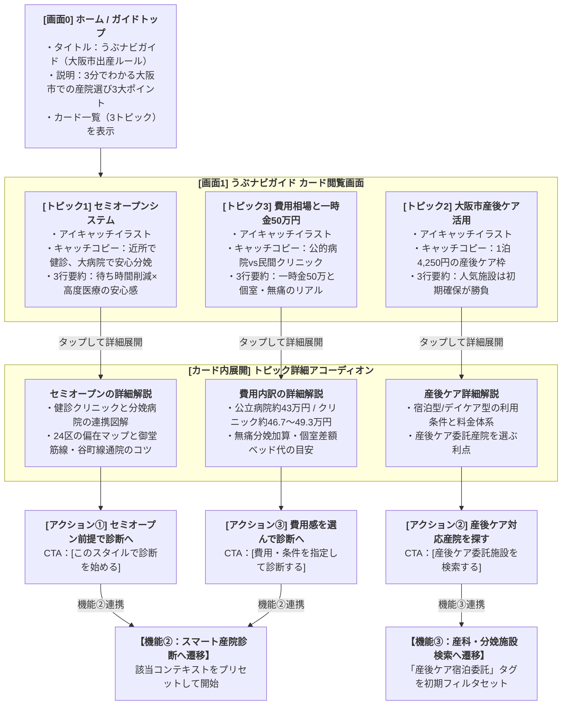

### 機能①：都市医療インフラのステップ解説「うぶナビガイド」（大阪市版）UX設計書 (v0.2)

#### 1. 前提知識：大阪市特有の医療・制度トラップ解体マトリクス
地方から大阪市内に移住した初産婦・パートナーが妊娠初期（4〜6週）に直面する3つの地域固有構造について、従来の地方都市の常識との落差と「うぶナビガイド」による解決アプローチを整理します。

| 大阪市特有の構造・トラップ | 地方都市・一般的な常識 | 大阪市内の現実とリスク | 「うぶナビガイド」での解消アプローチ |
| ------ | ------ | ------ | ------ |
| **1. セミオープンシステム** | 「近所の産婦人科に通い、そのまま同じ病院で産む」のが当然。 | 医療機能集約化のため、妊娠33〜34週までの健診は近所のクリニック、分娩は周産期医療センターや総合病院で行う役割分担が標準化。構造を理解しないと病院選びで迷走する。 | 健診と分娩を分けるメリット（通院負荷軽減＋高機能分娩の安心感）を1分で図解・解説し、認知のハードルを下げる。 |
| **2. 24区の産科偏在 ＆ 産後ケア早期確保戦** | 「住んでいる行政区内で分娩予約を取る」のが簡単。 | 区によっては個人産科クリニックがゼロに近く、御堂筋線・谷町線等の交通網を踏まえた区外通院が必要。また、破格の大阪市産後ケア（1泊2日4,250円）は人気施設が妊娠初期〜中期で埋まる。 | 24区の偏在リスクと産後ケア委託施設を早期に選ぶ重要性を明示し、通院アクセスと産後回復を両立する視点を提供。 |
| **3. 出産費用と一時金50万円のギャップ** | 「出産育児一時金（50万円）でほとんどカバーできる」という認識。 | 公立・総合病院平均（約43万円）と民間クリニック平均（約46.7万〜49.3万円）の差に加え、個室代や無痛分娩加算（+10万〜20万円）で自己負担額が大きく変動する。 | 一時金50万円を基準とした実費自己負担のシミュレーション目安を示し、費用と快適性のトレードオフを可視化。 |

--------------------------------------------------------------------------------

#### 2. ガイドUXの概要
##### 2.1 何ができるか？（UXコアバリュー）
知識が全くない妊娠初期の妊婦（つわりピーク時）や仕事で多忙なパートナーでも、**「1画面1トピック・文字数最小限」のカード型コンテンツをタップ・スワイプするだけ**で、以下のUX価値を提供します。

1. **「知る」ハードルの極小化（1画面1トピック設計）**
   * 長文の行政Webサイトや難解な医療記事を読む気力がないつわり期でも、スライド感覚（1トピック30秒）で大阪市の出産ルールと全体像を把握できます。
2. **迷いを解消するアクション誘導（診断・検索へのプリセット連携）**
   * 各トピックの末尾に、理解した知識をそのまま行動に移せるダイレクトボタンを配置。「セミオープンを希望して診断する」「産後ケア対応施設を検索する」などの条件がプリセットされた状態で機能②（診断）や機能③（検索）へシームレスに遷移します。
3. **夫婦の知識ギャップの短時間埋め合わせ**
   * パートナー（夫）へも「これだけ読めば大阪の病院選びの理由がわかる」3分Digestとして提示でき、夫婦間の前提知識を短時間で同期できます。

--------------------------------------------------------------------------------

##### 2.2 3大ガイドトピックのコンテンツ構造マトリクス

| トピックID | トピックタイトル | 主な解説内容 ＆ 定量データ | 読了後のユーザーの気付き | 設置するアクションボタン（CTA連携） |
| ------ | ------ | ------ | ------ | ------ |
| **TOPIC-01** | **近所で健診、大病院で安心分娩！<br>大阪市のセミオープンシステム** | ・「健診クリニック（〜34週）」と「分娩病院」を分ける大阪市の標準スタイル解説<br>・毎回の通院待ち時間短縮 ＆ 緊急時の大病院連携の二重安心メリット<br>・大阪市24区の産科偏在（区内に分娩施設が少ないエリアの対策） | 「近所に分娩施設がなくても、健診だけ近所で受けて大きい病院で産めばいいんだ！」 | **[セミオープン希望で診断してみる]**<br>➔ 機能② Q4へ「セミオープン希望」プリセット遷移 |
| **TOPIC-02** | **1泊2日4,250円！<br>大阪市産後ケアをフル活用する産院選び** | ・全国主要都市でも破格な大阪市産後ケア事業（宿泊型）の概要<br>・人気施設（委託産婦人科・助産所）は妊娠初期〜中期で予約が埋まる現実<br>・「産後ケア併設/委託の産院」を分娩先に選ぶメリット | 「産後の回復のために、妊娠初期の今から産後ケア枠を意識して病院を選ばなきゃ！」 | **[産後ケア委託施設を検索する]**<br>➔ 機能③ へ「特徴タグ：産後ケア宿泊委託」セット遷移 |
| **TOPIC-03** | **出産育児一時金50万円と<br>大阪市内のリアル費用相場** | ・一時金50万円の基本適用<br>・公的病院平均（約43万円：持ち出しほぼゼロ〜少額）<br>・民間クリニック平均（約46.7万〜49.3万円：個室代や手厚いアメニティ）<br>・無痛分娩加算（+10万〜20万円等）の予算感 | 「自分たちが重視するのは『費用を抑えること』か『個室や無痛の快適さ』かが分かった！」 | **[希望の費用・快適さで診断する]**<br>➔ 機能② Q5へ「費用・アメニティ重視度」選択へ遷移 |

--------------------------------------------------------------------------------

#### 3. 画面遷移図 ＆ カード閲覧フロー（Mermaid）
ガイド一覧から各カードの閲覧、アコーディオンによる詳細確認、および機能②（診断）・機能③（検索）への接続フローを定義します。



--------------------------------------------------------------------------------

#### 4. 表示項目 ＆ 機能②・機能③への連携仕様

##### 4.1 ガイド画面のUI表示項目仕様
各トピックカードおよび詳細画面で表示する8つの基本要素を定義します。

| 表示項目 | カード一覧時 | 詳細展開時 | UI/UX上の役割と表示ポイント |
| ------ | ------ | ------ | ------ |
| **1. トピックバッジ** | ● | ● | 「医療制度」「自治体ケア」「費用・予算」等のカテゴリ区分バッジ |
| **2. トピックタイトル** | ● | ● | 結論がひと目で伝わるキャッチコピー（例：「近所で健診、大病院で安心分娩！」） |
| **3. アイキャッチイラスト** | ● | ● | つわり期でも直感的に内容を想起できる親しみやすいイラスト |
| **4. 要点3行サマリー** | ● | ● | 弾丸ポイント（箇条書き）で要点のみを3秒で読めるように提示 |
| **5. 図解・比較チャート** | - | ● | セミオープンの役割分担図、または公的vs民間の費用比較バーチャート |
| **6. 解説本文（Q&A形式）** | - | ● | 初産婦が疑問に思うポイントを「Q. 途中で病院が変わって不安じゃない？」等の対話形式で解説 |
| **7. 大阪市特化注記** | - | ● | 「※大阪市24区の事業要綱に基づきます」等の信頼性を担保する根拠注記 |
| **8. ダイレクトアクションCTA** | ●（ミニボタン） | ●（大型ボタン） | 理解した内容に基づき診断（機能②）または検索（機能③）へ直結するボタン |

--------------------------------------------------------------------------------

##### 4.2 機能②（スマート産院診断）・機能③（施設検索）への連携パラメータ仕様
ユーザーがガイドを読んだ後に各CTAボタンをタップした際、後続機能へ引き渡す条件・コンテキスト引継ぎ仕様です。

| 送信元ガイドCTA | 遷移先機能 | 引き渡すプリセットパラメータ / 初期動作 | ユーザーが得られるシームレス体験 |
| ------ | ------ | ------ | ------ |
| **[TOPIC-01 CTA]<br>「セミオープン希望で診断してみる」** | 機能②（スマート産院診断） | `preset_q4_preference = "semi_open"`<br>（診断開始後、Q4「通院の利便性」で「セミオープン希望」を初期選択状態にして進行） | ガイドで学んだ「セミオープン」を選択肢として意識した状態でスムーズに診断を進められる。 |
| **[TOPIC-02 CTA]<br>「産後ケア委託施設を検索する」** | 機能③（施設検索） | `initial_filter_tags = ["産後ケア宿泊委託"]`<br>（施設検索一覧画面で「産後ケア宿泊委託」タグがオンになった状態で開く） | 破格な大阪市産後ケアの対象施設だけを即座に一覧・比較できる。 |
| **[TOPIC-03 CTA]<br>「希望の費用・快適さで診断する」** | 機能②（スマート産院診断） | `jump_to_question = "Q5"` または `highlight_q5 = true`<br>（費用・アメニティ重視度の質問項目へフォーカスして診断を開始） | 自分たちの予算感に合った施設タイプ判定へダイレクトに進める。 |

--------------------------------------------------------------------------------

#### 5. データ管理仕様：静的JSON/定数ファイル構造 (Single Source of Truth)

##### 5.1 設計方針
行政制度（出産育児一時金や産後ケア利用料改定）や医療機関の平均費用の変動に対応するため、ガイド内の解説テキスト・比較数値、および診断・検索ロジックで使用する数値・金額データをコンポーネント内に直接ハードコードせず、**単一の静的JSON/定数ファイル（例: `osaka_maternity_master.json`）**として分離管理します。

##### 5.2 データ構造定義（`osaka_maternity_master.json`）

```json
{
  "version": "2026.1",
  "last_updated": "2026-11-16",
  "jurisdiction": "大阪市",
  "subsidies_and_grants": {
    "childbirth_grant": {
      "amount": 500000,
      "unit": "JPY",
      "label": "出産育児一時金",
      "description": "国より支給される標準出産一時金"
    },
    "postpartum_care": {
      "stay_type_daily_fee": 4250,
      "unit": "JPY",
      "stay_type_standard_duration": "1泊2日",
      "label": "大阪市産後ケア（宿泊型）自己負担額",
      "description": "大阪市委託施設利用時の標準自己負担料金"
    }
  },
  "cost_market": {
    "public_and_general_hospital": {
      "average_total": 430000,
      "estimated_out_of_pocket": 0,
      "unit": "JPY",
      "label": "公立・総合病院（平均費用）"
    },
    "private_maternity_clinic": {
      "average_range_min": 467000,
      "average_range_max": 493000,
      "painless_delivery_option_min": 100000,
      "painless_delivery_option_max": 200000,
      "unit": "JPY",
      "label": "民間産婦人科クリニック（平均費用・オプション）"
    }
  },
  "regional_rules": {
    "semi_open_system": {
      "checkup_limit_week": 34,
      "label": "セミオープン健診受診推奨上限（妊娠33〜34週）"
    },
    "booking_deadline_alert_week": 12,
    "label": "分娩予約アラート境界週数（12週）"
  }
}
```

##### 5.3 画面および他機能（診断・検索）での動的バインド・参照仕様

1. **ガイド画面での動的バインド**:
   * UIレンダリング時、解説テキスト内の数値（「1泊2日4,250円」「50万円」「43万円〜」等）はハードコードせず、本マスターデータから動的埋め込みを行う（例: `{{subsidies_and_grants.postpartum_care.stay_type_daily_fee | currency}}`）。
2. **機能②（診断）および機能③（検索）でのデータ共有**:
   * 機能②における「自己負担額計算（一時金50万円との差額）」や機能③における「費用目安バッジ」の計算処理でも同一のJSONマスターを参照し、全機能間での**表記の不整合（表記揺れ）の防止**と**制度変更時の1箇所修正（Single Source of Truth）**を実現する。
