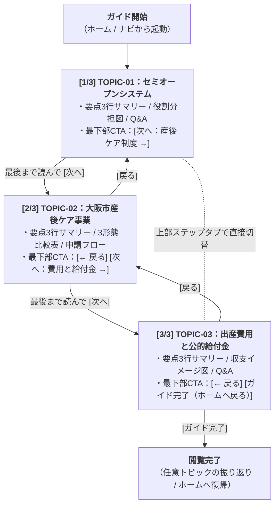

### 機能①：都市医療インフラのステップ解説「うぶナビガイド」（大阪市版）UX設計書 (v0.7)

#### 1. 前提知識：大阪市特有の医療・制度トラップ解体マトリクス
地方から大阪市内に移住した初産婦・パートナーが妊娠初期（4〜6週）に直面する3つの地域固有構造について、従来の地方都市の常識との落差と「うぶナビガイド」による解決アプローチを整理します。

| 大阪市特有の構造・トラップ | 地方都市・一般的な常識 | 大阪市内の現実とリスク | 「うぶナビガイド」での解消アプローチ |
| ------ | ------ | ------ | ------ |
| **1. セミオープンシステム** | 「近所の産婦人科に通い、そのまま同じ病院で産む」のが当然。 | 医療機能集約化のため、区によっては個人産科クリニックがゼロに近く、通院や分娩先の確保に困惑するケースが発生。健診と分娩を分ける選択肢を知らないと病院選びで迷走する。 | 「近所に分娩対応施設が少なくても大丈夫！」という選択肢として、近所健診（〜34週）×大病院分娩の通院軽減・安心メリットを1分で図解・解説。 |
| **2. 24区の産科偏在 ＆ 産後ケア活用** | 「住んでいる行政区内で分娩予約を取る」のが簡単。 | 大阪市の産後ケアは非常に手厚い一方、宿泊・通所・訪問の使い分けや妊娠8か月からの事前申請フローを知らないと活用機会を逃す。 | 3つのケア形態（宿泊・通所・訪問）の全体像と申請手続きのステップをわかりやすく提示し、自分に合った産後サポートを早期に見通せる安心感を提供。 |
| **3. 出産費用と公的給付金（一時金＋市給付金）** | 「出産育児一時金（50万円）くらいしか公的支援はない」という認識。 | 大阪市内の分娩施設は出産なび（2025年4〜9月実績）で平均50万円台〜70万円台が中心（掲載22施設すべて平均50万円超）であり、一時金50万円だけでは数万〜20万円以上の自己負担が生じやすい一方、**大阪市の妊婦支援給付金（計10万円）** などの自治体固有の現金給付制度を知らないと資金計画で不安を抱え込みやすい。 | 一時金50万円に加え、大阪市の妊婦支援給付金（計10万円：妊娠時5万円＋出産時5万円/人）を合わせた **計60万円の公的支援** と実際の費用相場・加算要因（無痛分娩・個室代等）を明示し、資金面の不安を大幅に軽減。 |

--------------------------------------------------------------------------------

#### 2. ガイドUXの概要
##### 2.1 何ができるか？（UXコアバリュー）
知識が全くない妊娠初期の妊婦（つわりピーク時）や仕事で多忙なパートナーでも、**1画面1トピック完結のガイドを読み進めるだけ**で、以下のUX価値を提供します。

1. **「知る」ハードルの極小化（1画面1トピック設計）**
   * 長文の行政Webサイトや難解な医療記事を読む気力がないつわり期でも、スライド感覚（1トピック30秒）で大阪市の出産ルールと全体像を把握できます。
2. **純粋な「知識インプット・疑問解消」への完全特化**
   * 他機能（診断・検索）への画面移動やアクションボタン（CTA）を一切持たせず、ガイド内での純粋な知識の閲覧と疑問解消に特化したシンプルな操作体験を提供します。
3. **夫婦の知識ギャップの短時間埋め合わせ**
   * パートナー（夫）へも「これだけ読めば大阪の病院選びの理由がわかる」3分Digestとして提示でき、夫婦間の前提知識を短時間で同期できます。

--------------------------------------------------------------------------------

##### 2.2 3大ガイドトピックのコンテンツ構造マトリクス

| トピックID | トピックタイトル | 主な解説内容 ＆ 定量データ | 読了後のユーザーの気付き |
| ------ | ------ | ------ | ------ |
| **TOPIC-01** | **近所に分娩施設が少なくても大丈夫！ 通院をラクにする「セミオープン」という選択肢** | ・区によって分娩施設が少ない大阪市特有の悩みを解消する「選択肢」として紹介 ・毎回の健診（〜34週頃）は近所、出産は大病院という役割分担の仕組み ・「同じ病院に通い続けるスタイル」とも自由に比較できる安心感を提示 | **「自宅近くに分娩できる病院がなくても、この仕組みを使えば通院がラクになって選択肢が広がるんだ！」** |
| **TOPIC-02** | **宿泊・通所・訪問から選べる！ 大阪市産後ケア事業の全体像と活用ガイド** | ・3つの形態（ショートステイ 1泊4,250円 / デイケア 1,500円 / 訪問 500円）の概要と費用 ・助産師等による母体ケア・授乳指導・沐浴指導などのサポート内容（ママ自身の育児自立支援） ・妊娠8か月からの事前申請（行政オンライン等）〜施設予約の手続きフロー | **「宿泊だけじゃなくデイケアや訪問もあるんだ！妊娠8か月からの事前申請の流れが分かって安心した！」** |
| **TOPIC-03** | **出産一時金50万円 ＋ 大阪市給付金計10万円！ 妊娠・出産にかかるお金と持ち出し相場** | ・出産育児一時金（50万円）の基本適用 ・**大阪市妊婦支援給付金（計10万円：妊娠認定時5万円 ＋ 届出時5万円/人）**の概要・申請要件（面談等） ・一時金50万円＋市給付金10万円（計60万円）に対し、大阪市内の分娩費用は50万〜70万円台中心（出産なび2025年4〜9月実績では掲載施設すべて平均50万円超）という実際の持ち出し相場 ・個室代や無痛分娩加算（+10万〜15万円前後 ※施設・条件により変動）を踏まえた実務的な自己負担の考え方 | **「一時金50万円に加えて市から計10万円の給付（合計60万円）もあるんだ！実際の相場と合わせて資金計画が見通せて安心した！」** |

--------------------------------------------------------------------------------

#### 3. 画面遷移図 ＆ ステップ進行フロー（Mermaid）
1画面内にトピックの要約・図解・Q&Aをコンパクトに収め、最後まで読み進めると次のトピックへ遷移できるステップ進行型の完結フローを定義します（上部のステップインジケータから任意トピックへの直接切替も可能）。

--------------------------------------------------------------------------------

#### 4. 表示項目 ＆ ガイド画面UI仕様

##### 4.1 ガイド画面のUI表示項目仕様
各トピック画面（1画面完結）で表示する9つの基本要素を定義します。

| 表示項目 | 表示位置（1画面完結） | UI/UX上の役割と表示ポイント |
| ------ | ------ | ------ |
| **1. ステップインジケータ** | 画面最上部 | `1/3`・`2/3`・`3/3` の進捗表示と、読みたいトピックへ直接ジャンプできるタブ |
| **2. トピックバッジ** | 上部ヘッダ | 「医療制度」「自治体ケア」「費用・給付金」等のカテゴリ区分バッジ |
| **3. トピックタイトル** | 上部ヘッダ | 結論がひと目で伝わるキャッチコピー（例：「一時金50万円 ＋ 大阪市給付金計10万円！」） |
| **4. アイキャッチイラスト** | 要約直上 | つわり期でも直感的に内容を想起できる親しみやすいイラスト |
| **5. 要点3行サマリー** | ファーストビュー | 弾丸ポイント（箇条書き）で要点のみを3秒で読めるように要約提示 |
| **6. 図解・収支イメージ図** | 画面中盤 | セミオープンの役割分担図、産後ケア3形態の比較表、または公的支援（計60万円）と大阪市内の出産費用レンジ（50万〜70万円台＋個室・無痛加算）の収支イメージ図（※同条件比較不可・最新費用は各施設HPで確認の注記付き） |
| **7. 解説本文（Q&A形式）** | 画面後半 | 初産婦が疑問に思うポイントを「Q. 途中で病院が変わって不安じゃない？」「Q. 大阪市の給付金10万円はどうやって受け取るの？」等の簡潔な対話形式で解説 |
| **8. 大阪市特化注記** | 解説下部 | 「※大阪市24区の事業要綱に基づきます」等の信頼性を担保する根拠注記 |
| **9. ステップ遷移ナビゲーション** | 画面最下部 | 最後まで読んだ後に迷わず次のトピックへ進める `[次へ：〇〇 →]` ボタン（2トピック目以降は `[← 戻る]`、最終トピックは `[ガイド完了]` を配置） |

##### 4.2 静的コンテンツ・制度数値の管理方針
* 本機能は3トピック固定の静的コンテンツであり、専用のJSONスキーマやテンプレート埋め込み仕様は設けない。
* ただし、`50万円`（出産育児一時金）、`計10万円`（大阪市妊婦支援給付金）、`1泊4,250円 / 通所1,500円 / 訪問500円`（産後ケア利用料）、`+10万〜15万円前後`（無痛分娩加算目安）といった制度・相場の数値はコンポーネント内に直接散在させず、フロントエンドの軽量な定数モジュールで一元管理して表記揺れ・改定時の修正漏れを防ぐ。
