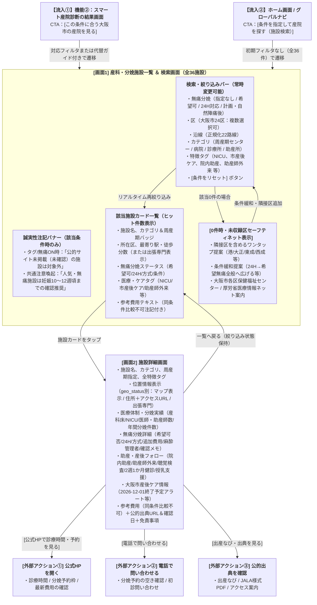

# 機能③：産科・分娩施設検索（大阪市版）UX設計書

> **データ仕様準拠**: 本設計書は、実データに基づきバッチ生成された正規化済みマスターデータ（[osaka_maternity_facilities.csv](../data/osaka_maternity_facilities.csv)）およびデータ仕様書（[osaka_maternity_facilities_doc.md](./osaka_maternity_facilities_doc.md)）に完全準拠してアップデートされています。

---

## 1. 施設検索UXの概要

### 1.1 何ができるか？（UXコアバリュー）
大阪市内の**分娩取扱施設（36施設：病院20件・診療所10件・有床助産所4件・出張専門助産所2件）**を、ユーザーの状況に合わせて柔軟に検索・比較・検討し、公的出典と一次情報に基づいた判断材料を確認したうえで、公式Webサイトや電話での予約確認アクションへ繋げる機能です。

本機能は、以下の**3つの異なるユーザーストーリー（利用導線）**を満たす設計とします。

1. **ストーリーA：診断結果から絞り込まれた候補を見る（機能②からの連携）**
   - [機能②（スマート産院診断）](./ubunavi-osaka-func2-ux-spec.md) で導き出された方針が**初期フィルタとして自動セットされた状態**で一覧画面が開き、迷わず候補施設を確認できます。
2. **ストーリーB：診断後に条件を少し変えて再検索・比較する（条件の調整）**
   - 初期フィルタをベースにしつつ、「自分の住む区や通勤沿線でさらに絞る」「隣の区も含める」「24時間無痛だけに絞る」「条件を一度クリアして全施設を見る」といった**条件の変更・追加・解除**が一覧画面上で自在に行えます。
3. **ストーリーC：診断をせずに最初から細かい条件で探す（直接検索）**
   - すでに希望条件が固まっているユーザーやパートナーが、ホーム画面やナビゲーションから直接検索画面を開き、区・沿線・無痛分娩（希望可/24H/方式）・カテゴリ・特徴タグを指定して検索できます。

### 1.2 実データに基づく対象範囲と設計方針（MVP制約の明文化）
* **分娩取扱施設に特化（健診専門クリニック非収録）**: 現在のデータソースは「出産なび」で分娩提供が確認された36施設（うち施設種別「未確認」6施設は誤分類防止のためバッチ除外）を対象としています。**分娩設備のない健診専門クリニックは本DBの対象外**となるため、機能②で「里帰り出産（健診のみ希望）」となったユーザー等には、本検索の代替として「近隣の産婦人科（医療情報ネット／自治体案内）」または希望条件に応じたセーフティネット案内を表示します。
* **大阪市24区中20区をカバー（0件区への配慮）**: 実データ上、分娩取扱が確認されている施設は20区に存在し、**`港区`・`大正区`・`東成区`・`西成区` は対象施設0件**です。これら4区が選択された場合は即座に隣接区へのワンタップ拡大を提案します。
* **診療時間・写真・施設別予約リミット・予算ソートを扱わない理由**: 診察時間・写真・施設別の個別予約期限・個室有無は実データに網羅ソースが存在せず、また出産費用は施設ごとに集計条件が異なる（同条件比較不可、11件は未掲載/空欄、1件は無痛単価のみ掲載）ため、**誤解を生む数値比較や推測表記を行わず、一次情報＋公式HP確認導線を徹底**します。

---

## 2. 画面遷移図（検索・一覧・詳細フロー）

2つの流入経路（診断連携・直接検索）から、施設一覧、施設詳細、および外部確認アクションに至る画面遷移を定義します。

---

## 3. 検索・絞り込み項目

ユーザーが直感的に条件を指定・変更できる検索フィルタ項目です。各項目は `osaka_maternity_facilities.csv` の正規化カラムに1対1で対応します。

### 3.1 主要検索項目（優先フィルタ）

1. **無痛分娩（3軸直交フィルタ）**
   * **希望無痛フィルタ（ラジオ選択）**:
     * `指定なし`（全36件）
     * `希望による無痛分娩あり`（`painless_availability` が `elective` または `elective_conditional`：計19件）
     * `24時間無痛分娩対応のみ`（上記のうち `painless_24h === 'yes'`：計7件）
   * **分娩方式サブフィルタ（希望無痛選択時、任意チェック）**:
     * `計画分娩に対応`（`PAINLESS_SCHEDULED`：12件）
     * `自然陣痛後に対応`（`PAINLESS_SPONTANEOUS`：10件）
   * **データ安全ルール**:
     * `医学的適応のみ（2件）`、`和痛分娩・筋注（1件）`、`未確認（4件）` は「希望による無痛分娩あり」の検索結果に**絶対に混ぜない**。
     * `elective_conditional`（1件：なかがわレディースクリニック）はヒット対象としつつ、カード上に「経産婦のみ等・条件あり」バッジを必ず表示する。
     * 「希望による無痛分娩あり」やサブフィルタをONにした場合、画面上部に「※無痛分娩の実施有無が公的サイトで未確認の施設（4件）は除外して表示しています」と注記する。

2. **所在区（大阪市24区・複数選択可）**
   * 大阪市24区すべてを選択肢に表示（括弧内に収録件数を表示）。
   * 収録0件の4区（`港区`・`大正区`・`東成区`・`西成区`）を選択して該当0件となった場合、0件セーフティネット画面で隣接区（例：`港区`→`西区`/`此花区`、`大正区`→`浪速区`/`西区`、`東成区`→`天王寺区`/`城東区`/`生野区`、`西成区`→`住吉区`/`阿倍野区`/`浪速区`）をワンタップで追加提案する。

3. **沿線（複数選択可）**
   * 正規化路線マスタ（`lines` JSON配列）に含まれる **全22路線** を会社別（Osaka Metro / JR / 私鉄）にグループ化して表示。
   * 複数駅や乗換路線（例：`大阪赤十字病院` の鶴橋駅4路線、`にじいろ助産院` の十三駅3路線）も正しくヒットする。
   * 沿線フィルタをONにした場合、出張専門助産所2件（`access_type === 'home_visit_only'`）は対象外となる。

### 3.2 カテゴリ・特徴タグ絞り込み

* **カテゴリ（複数選択可）**:
  * `周産期母子医療センター`（`perinatal_center_level` が `comprehensive` または `regional`：8件）
  * `病院`（`facility_category === 'hospital'`：20件 ※周産期センター8件＋その他病院12件）
  * `診療所（クリニック）`（`facility_category === 'clinic'`：10件）
  * `助産所（有床・出張専門）`（`facility_category` が `midwife_inpatient` または `midwife_home_visit`：6件）
* **特徴タグ（`feature_tags` に基づくチェックボックス）**:
  * `NICUあり`（`NICU`：9件）
  * `ハイリスク対応可`（`high_risk_ready === true`：9件）
  * `大阪市産後ケア掲載`（`isOsakaPostpartumCareActive(facility, referenceDate)` が `true` の施設：2026-12-01未満は29件、2026-12-01以降は28件）
  * `院内助産あり`（`IN_HOSPITAL_MIDWIFERY`：5件）
  * `助産師外来あり`（`MIDWIFE_OUTPATIENT`：21件）
  * `授乳支援外来あり`（`BREASTFEEDING_CLINIC`：24件 ※自院出産者限定7件を含むため詳細で区分表示）
  * `2週間・1ヶ月産婦健診`（`POSTPARTUM_CHECKUP`：27件）
  * `麻酔科専門医が管理`（`ANESTHESIOLOGIST_MANAGED`：3件）
  * `駅徒歩3分以内`（`STATION_NEAR`：15件）

### 3.3 MVPで明示的に廃止（採用しない）フィルタ・ソート

| 廃止項目 | 廃止理由（実データ根拠） | 代替UX |
|---|---|---|
| **予算上限フィルタ・安い順ソート** | `cost_display_type` が混在し「同条件比較不可」。また11件が未掲載/空欄、1件（日本生命病院）は加算単価15万円のみ掲載のため、ソートすると重大な誤順位を生む。 | カード・詳細で原文テキストと「※同条件比較不可」注記を参考表示し、公式HP確認へ誘導。 |
| **検診のみ / セミオープン受入** | 実データ36件はすべて分娩取扱施設であり、健診専門施設が0件。セミオープン提携有無の網羅列も存在しない。 | 機能②の結果B/Eからはガイド・近隣検索や代替注記を提示。 |
| **個室あり / 夜間・土曜診療** | 元データに個室保有および外来診療時間の網羅カラムが存在しない。 | 詳細画面から「公式HP」へ誘導し最新情報確認を促す。 |

### 3.4 「未確認（`unknown`）」データの扱い原則
* **フィルタON時**: 確証が得られていない施設をユーザーに誤案内しないため、条件を満たすことが確定している施設のみを返す（例：`無痛分娩あり` 指定時は `unknown` の4件を除外し、その旨を注記表示）。
* **フィルタOFF（全件閲覧）時**: カードおよび詳細画面では「なし (`none`)」と「未確認 (`unknown`)」を明確に異なるラベル・バッジ（例：`無痛分娩：なし` vs `無痛分娩：公的未掲載（要確認）`）で表示し、未確認施設が実施していないかのように誤認させない。

---

## 4. 表示項目（一覧カード ＆ 施設詳細）

一覧画面では「候補の絞り込み・比較に必要なコア情報」を表示し、詳細画面では「一次情報・出典・連絡アクション」まで全項目を表示します。

### 4.1 一覧カード・詳細画面マッピング表

| 表示項目 | 対応カラム | 一覧カード | 詳細画面 | UX上の表示ルール・フォールバック仕様 |
|---|---|:---:|:---:|---|
| **1. 施設名** | `name` | ● | ● | 視認性の高い見出しとして表示。 |
| **2. カテゴリ・周産期バッジ** | `facility_category` `perinatal_center_level` | ● | ● | `総合周産期母子医療センター`、`地域周産期母子医療センター`、`病院`、`診療所`、`助産所（有床）`、`助産所（出張専門）` を色分け表示。 |
| **3. 無痛分娩ステータス** | `painless_availability` `painless_24h` `painless_timing` | ● | ● | `elective` / `elective_conditional` は「希望無痛可（24H / 計画 / 自然陣痛後 / 経産婦限定）」、その他は `医学的適応のみ`、`和痛分娩（筋注）`、`なし`、`未確認（要確認）`、`対象外（助産所）` を明確に表示。 |
| **4. 特徴・ケアタグ** | `feature_tags` | ●（主要） | ●（すべて） | カードでは最大4〜5個（`NICU`、`市産後ケア`、`24H無痛`、`院内助産`、`助産師外来` 等）を優先表示し、詳細は全件展開。 |
| **5. 所在区・アクセス** | `ward`, `access_type` `nearest_station` `station_walk_minutes` `lines`, `access_note` | ● | ● | `station`: 「〇〇区｜〇〇駅 徒歩〇分（路線名）」表示。 `home_visit_only`: 「〇〇区｜出張専門（通院不要）」表示。 |
| **6. 参考費用情報** | `cost_display_type` `cost_reference_text` | ● | ● | **5パターン分岐**： ・`delivery_range` / `delivery_single_or_avg`: 参考値＋「※同条件比較不可」 ・`painless_example`: 「無痛分娩掲載例：〇〇（比較不可）」 ・`painless_addon_only`: 「無痛分娩加算単価のみ：〇〇（出産総額ではありません）」 ・`unlisted`: `cost_reference_text` があれば公式参考価格を表示、空なら「公的サイト未掲載（公式HPでご確認ください）」。 |
| **7. 住所・マップ表示** | `geo_status`, `address` `latitude`, `longitude` `station_source_url` | 区名のみ | ●（条件分岐） | **4パターン分岐**： ・`resolved` (23件): 住所＋**画面内マップピン表示**。 ・`address_only` (1件): 住所テキスト＋「地図座標未登録のため公式アクセス案内をご確認ください」＋出典リンク。 ・`missing_source` (10件): 「住所・地図は公式アクセスページで確認」＋ `station_source_url` ボタン。 ・`not_applicable_home_visit` (2件): 「出張専門のため来院マップ非対象（拠点区：〇〇区）」表示。 |
| **8. 医療体制・分娩実績** | `nicu_beds`, `obstetric_beds` `obgyn_doctors`, `pediatric_doctors` `midwives_count`, `annual_*` | - | ● | 病床数・スタッフ数・年間経腟/帝王切開件数をグリッド表示。`""`（未確認/未登録）は `-` ではなく `未確認` と表記。 |
| **9. 助産・産後フォロー体制** | `in_hospital_midwifery` `midwife_outpatient` `newborn_hearing_test` `postpartum_checkup_2w_1m` `breastfeeding_clinic` | - | ● | `授乳支援外来` は `open_to_all`（一般利用可）と `delivered_here_only`（自施設出産者のみ）を区別して表示。 |
| **10. 大阪市産後ケア情報** | `postpartum_care_status` `postpartum_care_end_date` `postpartum_care_note` | バッジ | ● | `osaka_city_ending`（大阪警察病院：`2026-12-01` 終了予定）は、参照日以前は警告付き掲載中バッジ、**参照日が `2026-12-01` 以降は「市事業掲載終了」へ自動切替**。`birth_navi_only` は「出産なびに産後ケア表示（市事業要確認）」と注記。 |
| **11. 無痛分娩詳細・メモ** | `painless_extra_cost_note` `anesthesia_manager_type` `anesthesia_manager_note` `painless_memo` | - | ● | 追加費用・麻酔管理者資格を表示。出典差異などの `painless_memo` は「詳細・確認メモ」アコーディオン内に格納。 |
| **12. 行動導線・出典・免責** | `website_url`, `phone_number` `birth_navi_url`, `painless_source_url` `source_checked_date`, `extra_checked_date` `disclaimer_note` | - | ● | ・`[公式HPで診療時間・予約枠を見る]` ・`[電話で問い合わせる]`（ワンタップ発信） ・`[出産なび詳細]` / `[無痛分娩の出典]` リンク ・確認日および `disclaimer_note` をフッターに常時表示。 |

### 4.2 共通の分娩予約リミット注意喚起（一覧上部・詳細下部）
施設ごとの固定週数データが実在しないため、一覧画面のヘッダー部および詳細画面のCTA直上に、全施設共通のガイド注記を表示します（機能②の週数チェック結果が12週以降の場合は強調表示）。
> 💡 **分娩予約と診療時間の確認について**：大阪市の人気施設や無痛分娩枠は妊娠10〜12週頃までに埋まる場合があります。最新の予約受付状況・外来診療時間は必ず各施設の公式HPまたはお電話にて直接ご確認ください。

---

## 5. 機能②（スマート産院診断）からの連携仕様マッピング

機能②の診断結果から機能③へ遷移する際の初期フィルタ引継ぎ仕様を、実データのカラム仕様に合わせて定義します。

| 機能②の結果 | 推奨タイプ | 機能③への初期フィルタセット | 実データとの整合・補足ルール |
|---|---|---|---|
| **結果A** | 総合・地域周産期母子医療センター | `high_risk_ready = true`（またはカテゴリ：`周産期センター`＋`NICUあり`） | 周産期センター8件＋JCHO大阪病院（NICU 6床）の計9件がヒット。 |
| **結果B** | 近隣の健診クリニック（里帰り用） | **検索対象外ガイド画面 / リセット状態** | 実データ36件は分娩施設専用（健診専門0件）のため、結果画面または遷移時に「健診のみ対応クリニックは厚労省医療情報ネット等で近隣検索してください（分娩施設一覧を見ることも可能です）」と案内。 |
| **結果C** | 無痛分娩対応のクリニック / 病院 | 希望無痛：`elective` / `elective_conditional`（19件） | 医学的適応のみ・和痛分娩・未確認は除外し、24H可否や計画/自然陣痛後でさらに絞れる状態にする。 |
| **結果D** | 助産院 / フリースタイル対応施設 | カテゴリ：`助産所（有床・出張専門）`（6件）＋任意で `院内助産あり` 案内 | 助産所6件を初期表示。病院での助産師ケアに関心がある場合は「院内助産あり（5件）」もワンタップ追加可能にする。 |
| **結果E** | セミオープンシステム対応施設 | カテゴリ：`周産期センター` / `病院`（20件） | 健診専門クリニックがDB非収録のため、**分娩受け入れ側となる病院一覧を初期表示**し、「健診先の近隣クリニック連携可否は分娩希望病院の公式HPでご確認ください」の案内バナーを表示。 |
| **結果F** | 分娩可能な近隣の産婦人科クリニック | カテゴリ：`診療所（クリニック）`（10件） | 病院産科も含めたい場合はワンタップで「病院」も追加可能。 |
| **結果G** | 公立病院・総合病院（費用抑えめ傾向） | カテゴリ：`病院`（20件）＋注記バナー | 費用ソート・予算フィルタは行わず、「公的・総合病院を含めた病院一覧を表示しています。最新の分娩費用・差額ベッド代は公式HP等でご確認ください」と案内。 |
| **結果H** | サービス充実の民間クリニック・専門病院 | カテゴリ：`診療所（クリニック）`（10件）＋補助タグ選択可 | `個室あり` タグは廃止のため、個室や食事などのアメニティは公式HPで確認する旨を注記し、診療所一覧を提示。 |

---

## 6. データ連携・バッチ更新運用

1. **生成元**: `data/osaka_maternity_facilities.csv` は手編集禁止とし、必ず [build_osaka_maternity_facilities.mjs](../scripts/build_osaka_maternity_facilities.mjs) を実行して [ubunavi_osaka_integrated.csv](../data/ubunavi_osaka_integrated.csv) と [osaka_extracted/](../osaka_extracted) から再生成する。
2. **未確認施設・診療所座標の将来拡充**:
   * 元データで除外中の6施設は、施設種別が確認され `施設の種類` が更新され次第、次回のバッチ実行で自動的に検索対象（最大42施設・22区カバー）に組み込まれる。
   * `osaka_extracted/` に診療所基本情報CSV（`osaka_02-1_*.csv`）を追加してバッチを再実行すれば、現在 `missing_source` となっている診療所10件の住所・マップ座標もコード修正なしで自動補完される。
3. **時間経過に伴う更新**:
   * `postpartum_care_end_date`（現在1件：`2026-12-01`）の判定はアプリ表示・検索時の現在日付（またはサーバ基準日）で動的に行う。
