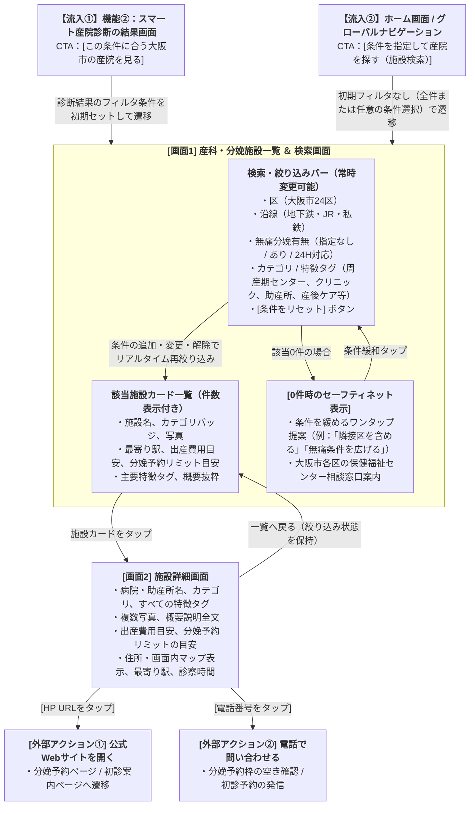

# 機能③：産科・分娩施設検索（大阪市版）UX設計書

## 1. 施設検索UXの概要

### 1.1 何ができるか？（UXコアバリュー）
大阪市内の産科病院・クリニック・助産所を、ユーザーの状況に合わせて柔軟に検索・比較・検討し、そのまま公式Webサイトや電話での予約確認アクションへ繋げる機能です。

本機能は、以下の**3つの異なるユーザーストーリー（利用導線）**をすべて満たす設計とします。

1. **ストーリーA：診断結果から絞り込まれた候補を見る（機能②からの連携）**
   - 機能②（スマート産院診断）で導き出された「自分に合う施設タイプ」が**初期フィルタとして自動セットされた状態**で一覧画面が開き、迷わず候補施設を確認できます。
2. **ストーリーB：診断後に条件を少し変えて再検索・比較する（条件の調整）**
   - 診断結果の初期フィルタをベースにしつつ、「自分の住む区や通勤沿線でさらに絞る」「やっぱり隣の区も見る」「計画無痛だけでなく24時間無痛に絞る」「診断条件を一度クリアして他タイプも見る」といった**条件の変更・追加・解除**が一覧画面上で自在に行えます。
3. **ストーリーC：診断をせずに最初から細かい条件で探す（直接検索）**
   - すでに希望条件が固まっているユーザーや、パートナーから「〇〇区か〇〇線沿線で無痛分娩ができる病院を調べて」と頼まれた夫が、**診断をスキップしてホーム画面やナビゲーションから直接この検索画面を開き**、区・沿線・無痛分娩有無・特徴タグを指定して検索できます。

---

## 2. 画面遷移図（検索・一覧・詳細フロー）

3つの流入経路（診断連携・直接検索・条件変更）から施設一覧、施設詳細、および外部予約アクションに至る画面遷移を定義します。

---

## 3. 検索・絞り込み項目

ユーザーが直感的に条件を指定・変更できる検索フィルタ項目です。診断結果からの遷移時は対応する条件がONになっており、ユーザー操作でいつでもON/OFFや条件追加が可能です。

### 3.1 主要検索項目（優先フィルタ）
- **無痛分娩有無**
  - `指定なし` / `無痛分娩あり（計画・24Hすべて）` / `24時間無痛分娩対応のみ`
- **区（大阪市24区）**
  - 北区、都島区、福島区、此花区、中央区、西区、港区、大正区、天王寺区、浪速区、西淀川区、淀川区、東淀川区、東成区、生野区、旭区、城東区、鶴見区、阿倍野区、住吉区、東住吉区、平野区、住之江区、西成区（複数選択可）
- **沿線**
  - Osaka Metro各線（御堂筋線、谷町線、四つ橋線、中央線、千日前線、堺筋線、長堀鶴見緑地線、今里筋線）、JR各線（大阪環状線、JR東西線、JRゆめ咲線等）、私鉄各線（阪急、阪神、近鉄、京阪、南海）

### 3.2 カテゴリ・特徴タグ絞り込み
- **カテゴリ**
  - `大病院（総合・地域周産期センター / 総合病院）`、`個人（産科クリニック）`、`助産所`
- **特徴タグ**
  - `計画無痛分娩`、`24H無痛`、`NICUあり`、`産後ケア宿泊委託`、`セミオープン受入`、`総合周産期医療センター`、`検診のみ`、`個室あり` 等

---

## 4. 表示項目（一覧カード ＆ 施設詳細）

一覧画面では「候補を素早く比較するためのコア情報」に絞って情報過多を防ぎ、タップ後の詳細画面で「受診・予約の意思決定に必要な全12項目」を表示します。

| 表示項目 | 一覧カード表示 | 詳細画面表示 | UX上の役割・表示のポイント |
| :--- | :---: | :---: | :--- |
| **1. 病院・助産所名** | ● | ● | 視認性の高い見出しとして表示 |
| **2. カテゴリ** | ● | ● | `大病院`、`個人（クリニック）`、`助産所` 等を色分けバッジで表示 |
| **3. 特徴タグ** | ●（主要のみ） | ●（すべて） | `計画無痛分娩`、`24H無痛`、`NICUあり`、`産後ケア宿泊委託`、`セミオープン受入`、`総合周産期医療センター`、`検診のみ`、`個室あり` 等 |
| **4. 写真** | ●（1枚） | ●（複数可） | 外観、病室（個室/大部屋）、食事などの雰囲気が伝わる写真 |
| **5. 最寄り駅** | ● | ● | 「〇〇線 〇〇駅 徒歩〇分」の形式で通院利便性を一目で把握可能にする |
| **6. 出産費用目安** | ● | ● | 「約〇〇万円〜」および出産育児一時金（50万円）との差額イメージを明記 |
| **7. 分娩予約リミットの目安** | ● | ● | 「妊娠〇週頃まで」「初診時に要予約」など、いつまでに動くべきかを強調表示 |
| **8. 概要説明** | 一部抜粋 | ● | 施設の特徴や分娩方針をわかりやすい言葉で要約 |
| **9. 住所・マップ** | 区名のみ | ●（マップ付き） | 詳細画面では正確な住所とともに画面内にマップを表示し、周辺環境や駅からの位置関係を直感的に把握可能にする |
| **10. 診察時間** | - | ● | 休診日・午前/午後の診療時間・夜間対応の有無（仕事と通院の両立判断に活用） |
| **11. HP URL** | - | ● | 公式Webサイト・Web予約ページへの遷移ボタン |
| **12. 電話番号** | - | ● | ワンタップで発信できる「分娩予約・初診の問い合わせ」ボタン |

