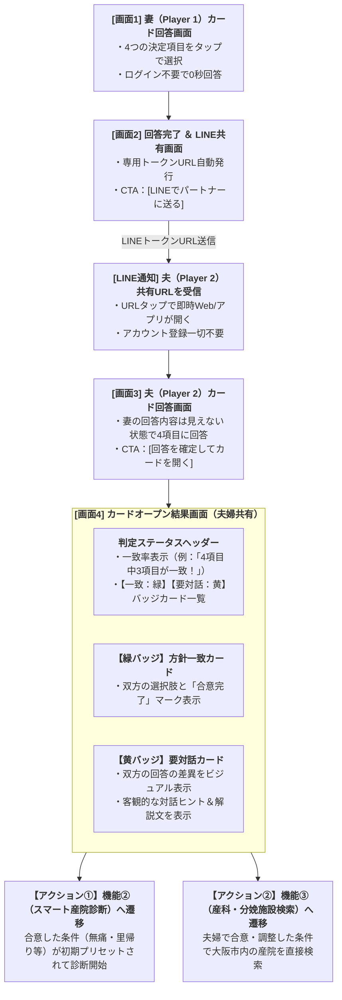
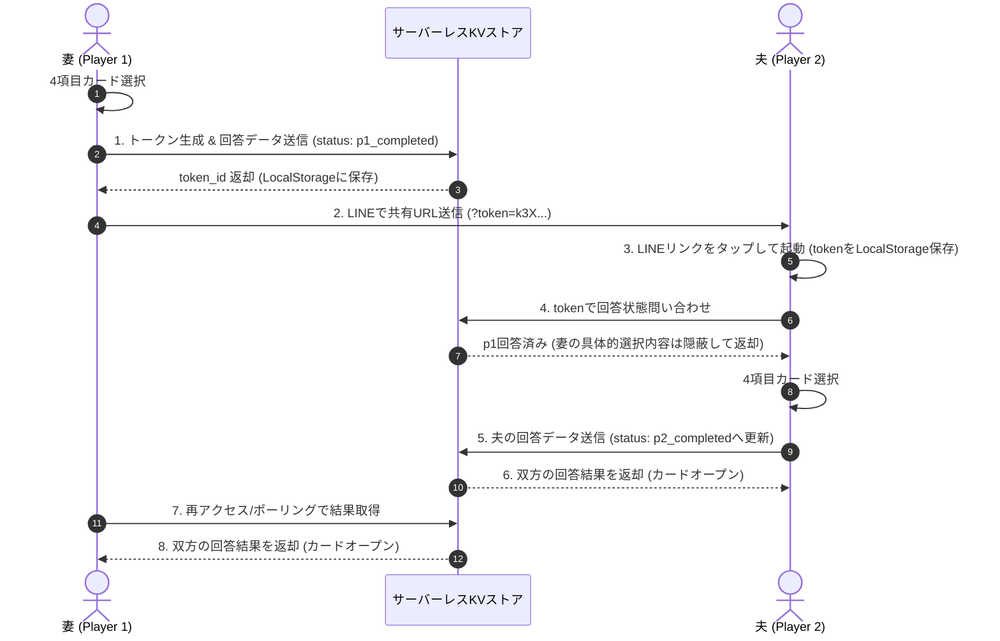

### 機能④：分娩ディシジョン・カード（夫婦の合意形成エンジン）UX設計書 (v0.3)

#### 1. 合意形成UXの概要
##### 1.1 何ができるか？（UXコアバリュー）
妊娠初期（4〜12週）における「無痛分娩」「出産予算上限」「里帰り出産」「産後ケア利用」等の重大決断において、夫婦それぞれの価値観や希望を非同期で入力・可視化し、感情的対立を避けながら建設的な合意形成を支援する機能です。

本機能は、以下の**3つのコア体験価値**を提供します。
1. **非同期回答 ＆ カード同時オープンによる感情的対立の防止**
   * 相手の回答に誘導されたり、その場でプレッシャーを感じることなく、各自のスマホで本音を選択できます。両者の回答が揃った瞬間にカードがオープンし、「完全一致（緑バッジ）」「要対話（黄バッジ）」を自動判定します。
2. **ログイン・会員登録ゼロの超低摩擦ペアリング（LINEトークン共有）**
   * つわり中の妻や多忙な夫がアカウント作成・ペアリング設定で脱落しないよう、ログインレス設計を徹底します。妻が回答後に発行される「専用共有リンク（トークン付きURL）」をLINEで夫に送信するだけで、認証なしで即座に回答・同期が完結します。
3. **対話ヒントの客観提示 ＆ 合意条件からの「診断（機能②）」「検索（機能③）」連動**
   * 要対話（黄色）項目には、なぜ意見が分かれやすいのか（医療知識や地域特有の背景）と対話の視点を客観的なアドバイスとして表示します。さらに、合意した条件をそのまま機能②（スマート産院診断）や機能③（施設検索）へ引き継ぎ、最適な産院探しへスムーズに移行できます。

--------------------------------------------------------------------------------

#### 2. ディシジョン・カード設問 ＆ 判定ロジックマトリクス
夫婦それぞれが回答する4つのコア項目について、設問・選択肢・一致判定基準・および要対話（黄色）時の対話ヒントを整理します。

| 決定項目 | 設問文 | 選択肢（夫婦共通） | 一致判定ロジック | 要対話（黄色）時の解説・対話ヒント |
| ------ | ------ | ------ | ------ | ------ |
| **1. 無痛分娩** | お産時の痛み緩和（無痛分娩）について、どう考えていますか？ | **A.** ぜひ希望したい（体調回復や恐怖軽減を重視）<br>**B.** 条件や費用次第で検討したい<br>**C.** 自然分娩（麻酔なし）を希望・基本でよい<br>**D.** パートナー（妻）の希望を100%優先したい | ・夫婦の希望方向性が同等（A/A, C/C等）または一方がD（相手優先）選択時は **一致（緑）**<br>・一方がA（強く希望）で他方がC（自然希望/否定的）の場合は **要対話（黄）** | **【無痛分娩の要対話ポイント】**<br>大阪市内の無痛分娩対応施設は予約枠が埋まりやすく（妊娠10〜12週の壁）、加算費用（+10万〜20万円程度）が発生します。「体調回復の速さ」と「予約期限・予算」のバランスについて、夫婦で優先順位を話し合いましょう。 |
| **2. 出産予算上限** | 出産費用（手出しの自己負担額）の上限イメージは？ | **A.** 一時金50万円の枠内に収めたい（自己負担ゼロ〜数万円）<br>**B.** +10万円程度までなら許容できる<br>**C.** +20万円以上でも快適さや無痛分娩を優先したい<br>**D.** 相場がわからないので相談して決めたい | ・選択区分が同等または許容差額が10万円以内の場合は **一致（緑）**<br>・一方がA（一時金枠内）で他方がC（+20万以上OK）など大幅なズレがある場合は **要対話（黄）** | **【予算上限の要対話ポイント】**<br>大阪市内の平均出産費用は約46.7万〜49.3万円ですが、個室代や無痛分娩、産後アメニティにより自己負担は大きく変わります。一時金50万円を超過する分の自己負担額について、どこまでを許容範囲とするか予算方針を擦り合わせましょう。 |
| **3. 里帰り出産** | 出産の場所（大阪市内 vs 実家・市外）はどうしたいですか？ | **A.** 大阪市内で出産したい（夫・パートナーも立ち会い・サポート）<br>**B.** 実家近く（大阪市外）へ里帰りして出産したい<br>**C.** まだ迷っている・話し合って決めたい | ・選択肢が完全一致（A/A, B/B）した場合は **一致（緑）**<br>・一方がA（大阪市内）で他方がB（里帰り）の場合は **要対話（黄）** | **【里帰り出産の要対話ポイント】**<br>里帰り出産の場合、大阪市内では「妊婦健診のみ」受けられるクリニック選びが必要になります。大阪市内で産む場合は夫のサポート体制や産後ケアの確保が重要になります。産直後の生活体制を考慮して決めましょう。 |
| **4. 産後ケア利用** | 大阪市の産後ケア事業（宿泊型：1泊4,250円等）を利用したいですか？ | **A.** ぜひ利用したい（人気施設を早期確保したい）<br>**B.** 体調や状況を見て必要なら検討したい<br>**C.** 特に利用しなくて大丈夫そう（自宅で過ごす）<br>**D.** 制度や内容をよく知らない | ・A/A, B/B, A/B等ポジティブ意向で共通する場合は **一致（緑）**<br>・一方がA（絶対利用したい）で他方がC（不要）またはD（知らない）の場合は **要対話（黄）** | **【産後ケア利用の要対話ポイント】**<br>大阪市の産後ケア（宿泊型）は1泊4,250円と破格ですが、委託施設を兼ねた産院の枠は早期に埋まります。「産直後の母体回復とメンタルケア」のための重要インフラとして、活用するかどうか早期に合意しておきましょう。 |

--------------------------------------------------------------------------------

#### 3. 画面遷移図（非同期ペアリング ＆ カードオープンフロー）
ログインレスのURL共有から、非同期でのカード回答、オープン結果表示、および他機能（機能②・機能③）への遷移フローを定義します。



--------------------------------------------------------------------------------

#### 4. 画面表示項目・状態別UI仕様 ＆ 他機能連携

##### 4.1 回答状態別のUI仕様（3つのステータス）
1. **状態1：片方（妻）のみ回答完了時**
   * **画面表示**：「パートナーの回答待ちです。共有リンクをLINEで送信してください」
   * **UI要素**：[共有リンクをコピー] [LINEで送る] ボタン。自分自身の回答結果の確認・修正が可能。
2. **状態2：パートナー（夫）閲覧・回答中**
   * **画面表示**：「〇〇さんからのディシジョン・カードが届いています。あなたの考えを選んでカードを開こう！」
   * **UI配慮**：相手がどの選択肢を選んだかはカードがめくられるまで完全に非表示（回答バイアスを防止）。
3. **状態3：両者回答完了（カードオープン時）**
   * **画面表示**：カードめくりアニメーションとともに全項目がオープンされ、緑（一致）と黄（要対話）が色分け表示される。
   * **下部CTAアクション**：
     * `[合意した条件で産院診断を試す（機能②へ）]`
     * `[この条件で大阪市の産院を探す（機能③へ）]`

##### 4.2 機能②（スマート産院診断）・機能③（施設検索）への条件引継ぎ仕様
夫婦のカードオープン結果から、自動抽出された条件を後続機能に自動セットして引き継ぎます。

| ディシジョン・カードの合意結果 | 機能②（診断）への引継ぎパラメータ | 機能③（施設検索）への引継ぎパラメータ |
| ------ | ------ | ------ |
| **里帰り：大阪市内で出産（A）** | Q1（里帰り確認）を「大阪市内」で自動回答 | エリア：大阪市24区 |
| **里帰り：里帰り出産（B）** | Q1（里帰り確認）を「里帰り」で自動回答 ➔ ショートサーキット | 特徴タグ：検診のみ / セミオープン連携 |
| **無痛分娩：希望する（A/B/D）** | Q3（分娩スタイル）を「無痛分娩」で自動回答 | 無痛分娩有無：あり（計画・24H） |
| **予算上限：一時金枠内（A）** | Q5（費用/アメニティ）を「費用重視」で自動回答 | カテゴリ：大病院 / 一時金枠内目安 |
| **予算上限：+20万以上OK（C）** | Q5（費用/アメニティ）を「快適さ/個室重視」で自動回答 | カテゴリ：個人クリニック / 特徴タグ：個室あり |
| **産後ケア：利用希望（A）** | 診断結果のアラート欄に「産後ケア委託施設優先」フラグ設定 | 特徴タグ：産後ケア宿泊委託 |

--------------------------------------------------------------------------------

#### 5. データ管理仕様：静的JSON/定数ファイル構造 (Single Source of Truth)

##### 5.1 設計方針
ディシジョン・カード内の選択肢で提示する金額閾値（出産育児一時金50万円、予算上乗せ額、無痛分娩加算額、産後ケア利用料等）、判定ロジックパラメータ、および「要対話（黄色）」時に表示するアドバイス解説テキスト内の数値データをコンポーネント内に直接ハードコードせず、機能①（うぶナビガイド）等と共通の**静的JSON/定数マスターデータ（`osaka_maternity_master.json`）**を参照・活用する設計とします。

##### 5.2 データ構造定義（`osaka_maternity_master.json` の機能④連携拡張スキーマ）

```json
{
  "version": "2026.1",
  "decision_cards": {
    "painless_delivery": {
      "id": "card_painless",
      "title": "無痛分娩",
      "options": [
        { "key": "A", "label": "ぜひ希望したい（体調回復や恐怖軽減を重視）" },
        { "key": "B", "label": "条件や費用次第で検討したい" },
        { "key": "C", "label": "自然分娩（麻酔なし）を希望・基本でよい" },
        { "key": "D", "label": "パートナー（妻）の希望を100%優先したい" }
      ],
      "match_rules": {
        "green_patterns": [["A","A"], ["B","B"], ["C","C"], ["*","D"], ["D","*"]],
        "yellow_patterns": [["A","C"], ["C","A"]]
      },
      "talk_advice_template": "【無痛分娩の要対話ポイント】\n大阪市内の無痛分娩対応施設は予約枠が埋まりやすく（妊娠10〜12週の壁）、加算費用（+{{cost_market.private_maternity_clinic.painless_delivery_option_min | to_ten_thousand}}万〜{{cost_market.private_maternity_clinic.painless_delivery_option_max | to_ten_thousand}}万円程度）が発生します。「体調回復の速さ」と「予約期限・予算」のバランスについて、夫婦で優先順位を話し合いましょう。"
    },
    "budget_limit": {
      "id": "card_budget",
      "title": "出産予算上限",
      "options": [
        { "key": "A", "label": "一時金{{subsidies_and_grants.childbirth_grant.amount | to_ten_thousand}}万円の枠内に収めたい（自己負担ゼロ〜数万円）", "max_out_of_pocket": 50000 },
        { "key": "B", "label": "+10万円程度までなら許容できる", "max_out_of_pocket": 100000 },
        { "key": "C", "label": "+20万円以上でも快適さや無痛分娩を優先したい", "max_out_of_pocket": 200000 },
        { "key": "D", "label": "相場がわからないので相談して決めたい", "max_out_of_pocket": null }
      ],
      "match_rules": {
        "max_acceptable_diff_jpy": 100000
      },
      "talk_advice_template": "【予算上限の要対話ポイント】\n大阪市内の平均出産費用は約{{cost_market.private_maternity_clinic.average_range_min | to_ten_thousand}}万〜{{cost_market.private_maternity_clinic.average_range_max | to_ten_thousand}}万円ですが、個室代や無痛分娩、産後アメニティにより自己負担は大きく変わります。一時金{{subsidies_and_grants.childbirth_grant.amount | to_ten_thousand}}万円を超過する分の自己負担額について、どこまでを許容範囲とするか予算方針を擦り合わせましょう。"
    },
    "postpartum_care": {
      "id": "card_postpartum_care",
      "title": "産後ケア利用",
      "talk_advice_template": "【産後ケア利用の要対話ポイント】\n大阪市の産後ケア（宿泊型）は1泊{{subsidies_and_grants.postpartum_care.stay_type_daily_fee | currency}}円と破格ですが、委託施設を兼ねた産院の枠は早期に埋まります。「産直後の母体回復とメンタルケア」のための重要インフラとして、活用するかどうか早期に合意しておきましょう。"
    }
  }
}
```

##### 5.3 画面および他機能（診断・検索）での動的バインド・判定処理仕様

1. **選択肢・アドバイス文の動的バインド**:
   * ディシジョン・カードの選択肢文面および要対話（黄色）カードで表示するアドバイス文内の金額表現（「一時金50万円」「1泊4,250円」「+10万〜20万円」等）言及箇所は、マスターデータから数値を動的に埋め込んでレンダリングする。
2. **一致判定ロジック（許容差額判定）の動的パラメータ参照**:
   * 「出産予算上限」カードの一致判定（緑 vs 黄）において、両者の許容自己負担額の差が `match_rules.max_acceptable_diff_jpy`（100,000円）以内であれば「一致（緑）」とみなし、100,000円を超える大きなギャップがある場合に「要対話（黄）」とする判定閾値をマスターデータから参照して処理する。
3. **他機能（診断・検索）引継ぎ時の整合性担保**:
   * ディシジョン・カードの合意結果を機能②（診断）や機能③（検索）へ引き渡す際、マスターデータに定義されたカテゴリコードや特徴タグコード（`産後ケア宿泊委託` 等）を共通キーとして使用することで、将来的なタグ名称変更やシステム拡張時にも全機能間で整合したデータ連携を維持する。

--------------------------------------------------------------------------------

#### 6. 技術仕様：LINE共有トークン発行・サーバーレスデータ同期・有効期限設計

##### 6.1 全体アーキテクチャ方針（サーバーレスKV ＋ クライアントLocalStorage）
PRDで定義された「会員登録・ログイン認証は作らない（離脱要因の徹底排除）」という方針のもと、夫婦間での非同期同期（妻の回答保存 → 夫への伝達 → 夫の回答保存 → 双方でのカードオープン表示）を実現するため、**「サーバーレスKVストア」＋「クライアントLocalStorage」**のハイブリッド構成を採用します。

* **サーバーレスKVストア（Cloudflare Workers KV / Vercel KV / Firebase Realtime DB等）**:
  ユーザー個人情報を保持せず、「ランダムトークンID」をキーにして夫婦の選択肢（A/B/C/D）データのみを一時保管する軽量データストア。
* **クライアントLocalStorage**:
  各自のスマホブラウザにセッション情報（`token_id`）を退避し、共有リンク再生成なしでアプリ復帰・状態復元を可能にする。

##### 6.2 トークンURL構造 ＆ データPayload Schema

###### トークンURLフォーマット
```text
/decision?token=k3X9mP2vQ8nR
```
* **トークン生成ロジック**: `NanoID` または `UUIDv4` から生成した12桁のランダム英数字。

###### サーバーレスKVデータ構造（Payload Schema）
```json
{
  "token_id": "k3X9mP2vQ8nR",
  "created_at": "2026-11-17T06:30:00Z",
  "expires_at": "2026-12-01T06:30:00Z",
  "status": "p1_completed",
  "p1_data": {
    "role": "wife",
    "painless": "A",
    "budget": "B",
    "hometown": "A",
    "postpartum_care": "A",
    "submitted_at": "2026-11-17T06:30:00Z"
  },
  "p2_data": null
}
```
* **ステータス遷移**:
  * `p1_completed`: 妻（Player 1）のみ回答完了・夫の回答待ち。
  * `p2_completed`: 夫（Player 2）も回答完了（カードオープン可能状態）。

##### 6.3 トークン有効期限（14日間）と期限切れUXハンドリング

* **有効期限**: **14日間（336時間）**
  * 妊娠初期の意思決定猶予（10〜12週の壁）を踏まえ、LINE共有からパートナーが回答するまでの期間（最大2週間）を確保。14日経過後にKVからTTL自動削除。
* **期限切れ時のUXハンドリング**:
  * 期限切れリンクアクセス時には「有効期限（14日間）が経過しました」という案内メッセージと、「`[新しくディシジョン・カードを作成する]`」ボタンを表示し、0秒で回答開始へ誘導する。

##### 6.4 クライアント状態管理（LocalStorage活用）

1. **妻（P1）端末**:
   * 4項目回答完了時に `token_id` を `ubunavi_decision_session` としてLocalStorageに保管。再起動時には自動で「回答待ち画面」または「カードオープン結果」を表示。
2. **夫（P2）端末**:
   * LINEリンク経由でアクセスした際に `token_id` を自身のLocalStorageに保存。夫が回答送信を完了すると `status` が `p2_completed` へ更新される。

##### 6.5 非同期データ同期シーケンスフロー


