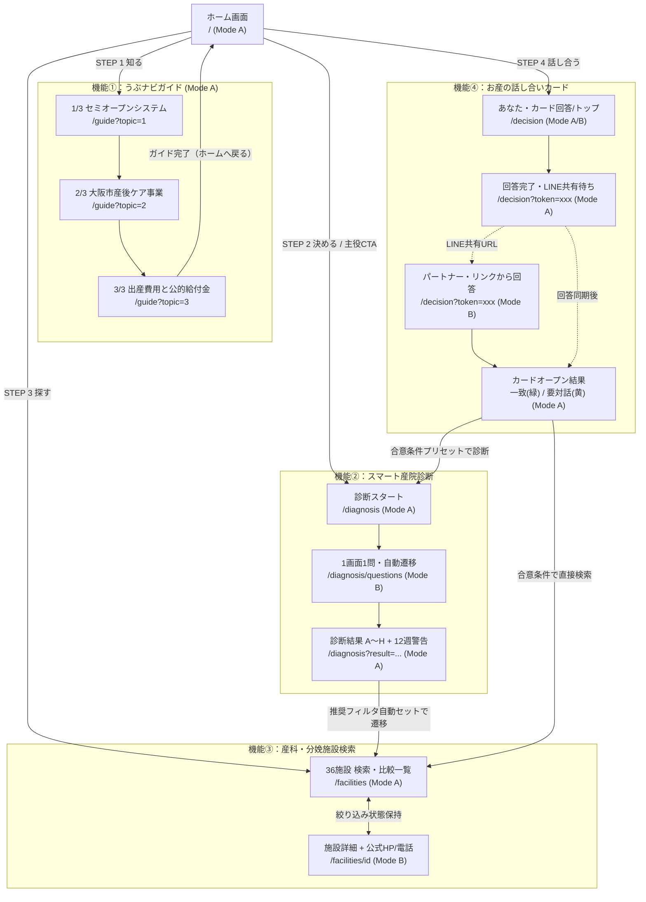

# うぶナビ大阪 共通レイアウト・UIデザインルール・ホーム画面設計書 (v1.1)

> **本ドキュメントの位置づけ（Single Source of Truth）**
> 本設計書は、`design/` 配下のPRDおよび機能①〜④のUX設計書・マスターデータ仕様書を統合し、**「つわりで辛い＆初産で不安が大きい妊婦への徹底した優しさ」**と**「ハッカソン審査員に全体像と配慮が即座に伝わる完成度」**を両立するためのUI設計基準を定義するものです。
> 実装チームおよびAIコーディングエージェントは、画面・コンポーネント実装時のUI上の唯一の正（Single Source of Truth）として本書を参照してください。

---

## 目次
- [第1章：デザインコンセプトと統合前提](#第1章デザインコンセプトと統合前提)
- [第2章：レスポンシブ共通レイアウト仕様（App Shell & Navigation）](#第2章レスポンシブ共通レイアウト仕様app-shell--navigation)
- [第3章：UIデザインシステム ＆ ルール](#第3章uiデザインシステム--ルール)
- [第4章：共通UIコンポーネント設計ルール（4機能横断仕様）](#第4章共通uiコンポーネント設計ルール4機能横断仕様)
- [第5章：ホーム画面 詳細設計仕様（コンテンツ・構造・状態変化）](#第5章ホーム画面-詳細設計仕様コンテンツ構造状態変化)
- [第6章：実装用デザイントークン ＆ 品質検証チェックリスト](#第6章実装用デザイントークン--品質検証チェックリスト)

---

## 第1章：デザインコンセプトと統合前提

### 1.1 参照仕様書（対象範囲）
本UI設計書は、以下のプロダクト要求・機能仕様・データ仕様を完全に実現するための横断UI仕様です。

| ドキュメント | 役割 | 本UI設計書で特に担保する要件 |
|---|---|---|
| [PRD v7](./ubunavi-osaka-prd-v7.md) | 全体要件・ペルソナ・非機能 | 妊娠初期4〜12週特化、**ログインレス0秒開始**、リアルタイム空き枠予約なし（公式HP/電話送客） |
| [機能① UX設計書 (v0.7)](./ubunavi-osaka-func1-ux-spec.md) | うぶナビガイド | 3トピック固定、**他機能へのCTA・スキップを置かない純粋な知識完結**、一時金50万＋市給付金計10万＝計60万・産後ケア（1泊4,250円等） |
| [機能② UX設計書](./ubunavi-osaka-func2-ux-spec.md) | スマート産院診断 | 最短2問・最長6問の早期確定型、1画面1問、文字入力ゼロ・**ワンタップ自動遷移**、柔軟な進捗表現、12週以降警告 |
| [機能③ UX設計書](./ubunavi-osaka-func3-ux-spec.md) | 産科・分娩施設検索 | 実データ**36施設・20区カバー**（港/大正/東成/西成0件時の隣接区提案）、費用比較・ソート廃止、`unknown` 厳格分離 |
| [機能④ UX設計書 (v0.3)](./ubunavi-osaka-func4-ux-spec.md) | 分娩ディシジョン・カード（UI表示名：**お産の話し合いカード**） | 非同期4問回答、`/decision?token=...`（14日間期限）、一致（緑）・要対話（黄／赤NG禁止）、診断・検索への条件引継ぎ |
| [マスターデータ仕様書](./osaka_maternity_facilities_doc.md) | 51カラム実データ契約 | `geo_status` 4分岐、`cost_display_type` 5分岐、大阪警察病院 `2026-12-01` 産後ケア終了動的判定、19種 `feature_tags` |

> **UI上の表記統一ルール（インクルーシブ配慮）**:
> [PRD v7](./ubunavi-osaka-prd-v7.md) や [機能④ UX設計書](./ubunavi-osaka-func4-ux-spec.md) の企画背景上にある「夫婦」「妻／夫」という表現は、未婚・入籍前・事実婚・ご家族との相談など多様な利用状況に寄り添うため、**UI上の表記ではすべて「あなた」「パートナー（相手・ご家族）」「お産の話し合いカード（短縮名：話し合い）」に統一**します。

---

### 1.2 デザインフィロソフィー：**「やすらぎ・明瞭・誠実（Warm Reassurance, Clarity & Honesty）」**

つわりの吐き気・めまい・光過敏を抱え、かつ「大阪でどうやって産院を決めればいいのか」と孤独に悩む初産婦にとって、一般的な医療情報サイトや多機能アプリの「情報過密」「まぶしい純白画面」「青白い寒色UI」「登録の壁」はそのまま離脱理由になります。

一方でハッカソン審査員は、短い試用時間の中で「課題の切実さ」「大阪市特化データの深さ」「4機能のつながり」「パートナー等との価値観すり合わせという独自性」を一瞬で確かめようとします。

この2つの視点を両立するため、すべての画面に以下の**3本柱**を貫きます。

1. **やすらぎ（Warm Reassurance）**：生成り色の低反射キャンバスと、助産師が隣で語りかけるようなトーンで、画面を見ること自体の身体負担と心理的プレッシャーを下げる。
2. **明瞭（Clarity）**：1画面1テーマ・余白の確保・片手親指完結・日本語テキストが読みやすい適度な角丸設計を徹底し、「今なにをすればいいか」で迷わせない。
3. **誠実（Honesty）**：公的データで確認できない項目を推測で埋めない（`unknown` 分離・費用比較禁止・出典と確認日の明示）。妊婦にも審査員にも嘘のない信頼体験を届ける。

---

### 1.3 2大考慮事項に対するUI設計転換マトリクス

| 対象 | 抱えている課題・リスク | 本設計書でのUI具体解 |
|---|---|---|
| **つわりで辛い妊婦** | 光刺激（まぶしい白・高彩度青）で吐き気がする／縦長ページや点滅・アニメーションで画面酔いする／長文で文字が追えない | ・メイン背景を温かな低反射アイボリー **`#FAF7F2`** に統一<br>・点滅（`animate-pulse`）やパララックス、自動スライドを全面禁止<br>・行間 **1.7倍**（15px/25.5px）・1説明あたり3行以内に制限<br>・キーボード入力と会員登録を完全にゼロ化 |
| **初産で不安が大きい妊婦** | 「12週までに決めないと手遅れ」という焦り／「大阪は制度が複雑で失敗しそう」／「相手とどう話せばいいかわからない」 | ・恐怖を煽る赤色や医療検査連想アイコン（心電図等）を使わない<br>・「あとから何度でもやり直せる」セーフティ文言を常設<br>・意見の違いを「NG」ではなく「じっくり話そう（淡アンバー）」で可視化<br>・婚姻形態を限定しない「あなた／パートナー」「話し合い」表現を採用 |
| **ハッカソン審査員** | 5秒で何のアプリか掴みたい／既存妊婦アプリとの違い（大阪市24区特化・話し合いカード）を知りたい／PC・スマホ双方での完成度を見たい | ・ホームのファーストビュー（実機約`550px`内）に価値と主役CTAを凝縮<br>・ホームを「ヒーロー → 4ステップ（話し合いプレビュー統合） → 出典フッター」の3ブロックに整理し、機能間の流れを一目で伝達<br>・PC閲覧時は画面幅を活かした横並びナビ・2カラムレイアウトへ自然に適応 |

---

## 第2章：レスポンシブ共通レイアウト仕様（App Shell & Navigation）

### 2.1 モバイルファースト ＆ PCレスポンシブフレーム設計

スマートフォン片手操作を起点（Mobile-First）としつつ、PCブラウザで調べるパートナーやPCで評価する審査員にとっても自然で比較しやすい**「アダプティブ・レスポンシブ設計」**を採用します。PCでモバイル画面を擬似枠に閉じ込める構成は採用しません。

| ビューポート幅 | ナビゲーション方式 | コンテンツ最大幅とレイアウト挙動 |
|---|---|---|
| **Mobile (`< 768px`)** | Stickyシンプルヘッダー（`56px`）＋ **固定ボトムナビ（`64px`・5タブ）** | 画面幅100%フルード表示（最小検証幅 **`360px`**、基準 **`375px`**）。`env(safe-area-inset-top/bottom)` を厳密適用。 |
| **Tablet / PC (`>= 768px`)** | **ボトムナビを非表示**とし、上部ヘッダー（`64px`）内に**5項目の横並びテキスト＋アイコンナビを統合** | 画面全体 `#FAF7F2` のまま、画面性質に応じた2種類の最大幅で中央配置：<br>・**ハブ／比較一覧系**（ホーム・機能③施設検索）：最大 **`1040px`**（ホーム4ステップは `2×2` グリッド、施設検索は左フィルタパネル＋右施設カード一覧）<br>・**読み物／集中タスク系**（機能①ガイド・機能②診断・機能④話し合いカード）：可読幅 **`680px`**（1行が長くなりすぎて読みづらくなるのを防止） |

---

### 2.2 2つのシェルモード（Shell Modes）

画面の目的に応じて、誤タップと情報ノイズを制御するため2種類のシェルモードを切り替えます。

```text
[Mobile < 768px]
+---------------------------+    +---------------------------+
|   Mode A：標準タブシェル   |    | Mode B：集中/詳細シェル    |
+---------------------------+    +---------------------------+
| [ヘッダー 56px]            |    | [ミニマルヘッダー 56px]    |
|  左: ロゴ / 右: 補助情報   |    |  左: [<- 戻る] / 中央: 題  |
+---------------------------+    +---------------------------+
|                           |    |                           |
|  スクロールコンテンツ       |    |  スクロールコンテンツ       |
|  (下部余白 pb: 84px確保)   |    |  (1問集中 or 施設詳細)     |
|                           |    |                           |
+---------------------------+    +---------------------------+
| [固定ボトムナビ 64px / 5]  |    | [ボトムナビ非表示]         |
| ホーム|ガイド|診断|検索|話 |    | ※施設詳細のみ固定CTAバー   |
+---------------------------+    +---------------------------+

[Tablet / PC >= 768px]
+-------------------------------------------------------+
| [PCヘッダー 64px] 左: ロゴ / 右: 5項目横並びナビ (Mode A) |
| ※Mode Bでは横並びナビを隠し [<- 戻る] + タイトルのみ表示  |
+-------------------------------------------------------+
|    ハブ・検索系: max-width 1040px (2列グリッド/2ペイン)   |
|    読み物・集中系: max-width 680px (中央1カラム可読幅)    |
+-------------------------------------------------------+
```

#### モード適用マッピング

| シェルモード | 適用ルート / 画面 | 採用理由（UX・つわり配慮） |
|---|---|---|
| **Mode A：標準ナビシェル** | ・`/`（ホーム）<br>・`/guide`（機能①：うぶナビガイド）<br>・`/diagnosis`（機能②：診断スタート・結果画面）<br>・`/facilities`（機能③：施設検索一覧）<br>・`/decision`（機能④：トップ・結果画面） | アプリの全体像を行き来でき、どの機能からでも迷わずホームや他機能へ移れる基準フレーム。 |
| **Mode B：集中タスク／詳細シェル** | ・`/diagnosis/questions`（機能②：Q1〜Q6回答中）<br>・`/facilities/[id]`（機能③：施設詳細画面）<br>・`/decision?token=...`（機能④：回答入力中画面） | 質問回答中や個別施設の確認中に誤って別ナビをタップする事故（誤操作によるやり直しストレス）を防ぎ、1画面の集中度を高める。施設詳細のみ下部固定CTAバーを表示。 |

---

### 2.3 共通ヘッダー詳細仕様

* **高さ**: Mobile **`56px`** + `env(safe-area-inset-top)` ／ PC（`>= 768px`） **`64px`**。
* **背景と境界**: `background: rgba(250, 247, 242, 0.90)`、`backdrop-filter: blur(12px)`、下辺 `1px solid #EAE3D9`。
* **絶対に配置しない要素**:
  * ログイン／会員登録ボタン（認証レス設計）
  * ハンバーガーメニュー（隠れた階層を作らない）
  * 通知ベルアイコン・未読バッジ（プレッシャーを与えない）
  * ヘッダー内検索バー（誤タップと視線分散を防止）

#### 画面別ヘッダー要素ルール

| 画面 | 左エリア | 中央 / 右エリア |
|---|---|---|
| **ホーム (`/`)** | 芽モチーフのロゴマーク（`22px`, `#236B58`）＋ **`うぶナビ大阪`**（`17px Bold`） | **Mobile**：右端に地域タグ **`大阪市24区特化`**<br>**PC**：右側に5項目グローバルナビ（`ホーム` / `ガイド` / `産院診断` / `産院検索` / `話し合い`） |
| **ガイド (`/guide`)**<br>**診断開始・結果 (`/diagnosis`)**<br>**施設一覧 (`/facilities`)**<br>**話し合いトップ・結果 (`/decision`)** | 上記共通ブランドロゴ（ホームへのリンク兼用） | **Mobile**：右端に簡潔な文脈表示（例：診断結果時は `やり直す`、施設一覧時は `○○件該当`、話し合い時は `登録不要・14日間`）<br>**PC**：右側に5項目グローバルナビ（現在画面をアクティブ表示） |
| **Mode B：診断質問中** | `[<- 前の質問へ]`（Q1時は `[<- やめる]` で戻る、`min 48×48px` タップ領域） | 中央に柔軟な進捗ラベル（例：`あなたに合う産院を整理中`）／右端に `[× 閉じる]` |
| **Mode B：施設詳細** | `[<- 一覧へ戻る]`（絞り込み条件を保持して復帰） | 中央：切り詰め可能な施設名（`truncate`, `15px Bold`） |
| **Mode B：話し合い回答中** | `[<- 戻る]`（共有リンクアクセス時は任意） | 中央：`お産の話し合いカード`／右端：`あと○問` |

---

### 2.4 ナビゲーション詳細仕様（Mobileボトムナビ ＆ PCヘッダーナビ）

#### 5項目定義表（Mobile・PC共通）

| 順番 | ラベル（日本語） | ルート | Material Symbols Icon | 選定理由（心理・インクルーシブ配慮） |
|:---:|---|---|---|---|
| **1** | **ホーム** | `/` | `home` | 迷ったらいつでも戻れる安全な拠点 |
| **2** | **ガイド** | `/guide` | `menu_book` | 本・ガイドの親しみやすい象徴 |
| **3** | **産院診断** | `/diagnosis` | `fact_check` | 検査・急変を連想させる心電図アイコンは使用せず、穏やかな確認・整理を示すアイコンを採用 |
| **4** | **産院検索** | `/facilities` | `local_hospital` | 産科・施設探しが直感的に伝わる象徴 |
| **5** | **話し合い** | `/decision` | `forum` | 婚姻形態を限定せず「対話・すり合わせ」を表す中立で柔らかな象徴 |

#### Mobile ボトムナビ仕様（`< 768px`, Mode Aのみ）
* **高さ**: **`64px`** + `env(safe-area-inset-bottom)`
* **背景と境界**: `background: rgba(250, 247, 242, 0.94)`、`backdrop-filter: blur(12px)`、上辺 `1px solid #EAE3D9`
* **レイアウト**: `display: grid; grid-template-columns: repeat(5, 1fr);`（幅360px端末でも1タブ `72px`、全タブのタップ高さ `48px` 以上）
* **アクティブ状態**: アイコン背景に `w-12 h-7 rounded-full bg-[#E6F3EE]` の淡セージピル＋アイコン `FILL: 1`（`#236B58`）＋ラベル `11px Bold`（`#236B58`、`whitespace-nowrap`）＋ `aria-current="page"`。
* **非アクティブ状態**: アイコン `FILL: 0`（`#636E71`）＋ラベル `11px Medium`（`#636E71`）。

#### PC ヘッダーナビ仕様（`>= 768px`, Mode Aのみ）
* **配置**: ヘッダー右端に横並び（`gap: 8px`〜`12px`）、1アイテムの高さ `40px`、水平パディング `12px`、角丸 `8px`。
* **アクティブ状態**: 背景 `#E6F3EE`、文字 `#185042` Bold、アイコン `FILL: 1`、`aria-current="page"`。
* **非アクティブ状態**: 背景透明（ホバー時 `#F4EFE7`）、文字 `#546063` Medium。

---

### 2.5 サイトマップ ＆ 画面遷移アーキテクチャ（Mermaid）

機能間のつながり（**機能①は他機能CTAを持たず完結**し、**機能②→機能③**および**機能④→機能②/③**で条件を引き継ぐこと）を以下に定義します。



---

## 第3章：UIデザインシステム ＆ ルール

### 3.1 カラーシステム（低反射・安心感・WCAG AA準拠）

画面全体のまぶしさを抑えるため、メイン背景は純白 `#FFFFFF` ではなく**温かな生成りアイボリー `#FAF7F2`** とし、その上に載せるカード面のみ `#FFFFFF` を使って柔らかな奥行きを作ります。文字色はすべて `#FAF7F2` および `#FFFFFF` 上で **WCAG 2.1 AA基準（本文 4.5:1 以上）** を満たす値を指定しています。

| トークン名 | HEX値 | 用途・適用箇所 | コントラスト比目安 |
|---|---|---|---|
| **Surface / Background** | | | |
| `--bg-canvas` | `#FAF7F2` | アプリ全画面の基本背景（Mobile・PC共通の低反射アイボリー） | — |
| `--bg-surface-card` | `#FFFFFF` | 各種情報カード・選択肢カードの面 | — |
| `--bg-surface-subtle` | `#F4EFE7` | 補助ボックス・Q&A背景・サブコンテナ | — |
| `--bg-surface-reassure` | `#EDF5F2` | 安心ポイント・ポジティブ注記の面 | — |
| **Border & Divider** | | | |
| `--border-default` | `#E6DFD5` | カード外枠・ヘッダー/ナビ区切り線（1px） | — |
| `--border-strong` | `#CFC5B8` | 未選択ボタン枠線・フォーカス時補助枠 | — |
| **Text / Ink** | | | |
| `--text-primary` | `#262D2E` | 見出し・本文・主要数値（純黒を使わない墨色） | 約 13.0:1（on `#FAF7F2`） |
| `--text-secondary` | `#546063` | 補足説明・カードサブコピー・駅情報 | 約 6.0:1（on `#FAF7F2`） |
| `--text-muted` | `#636E71` | 注記・確認日・非アクティブタブ（最小濃さ） | 約 4.8:1（on `#FAF7F2`） |
| **Primary（セージグリーン：医療的信頼・安堵・一致）** | | | |
| `--brand-primary` | `#236B58` | Primary CTA背景・アクティブタブ・一致バッジ強調 | 約 6.1:1（白文字） |
| `--brand-primary-hover` | `#1A5344` | Primary CTA押下・ホバー状態 | 約 8.4:1（白文字） |
| `--brand-primary-soft` | `#E6F3EE` | 安心タグ・一致カード背景・アイコン背景 | — |
| `--brand-primary-on-soft` | `#185042` | `--brand-primary-soft` 上のテキスト・アイコン | 約 7.9:1（on `#E6F3EE`） |
| **Accent（ウォームコーラル：ぬくもり・注目点）** | | | |
| `--accent-warm` | `#D9654B` | イラスト差し色・注目アイコン（装飾・大要素） | — |
| `--accent-warm-text` | `#B84730` | コーラル系テキスト・ラベル文字 | 約 5.4:1（on `#FFF0EC`） |
| `--accent-warm-soft` | `#FFF0EC` | 無痛分娩タグ・注目ラベル背景 | — |
| **Semantic（状態別：煽らず誠実に伝える）** | | | |
| `--status-match-bg` | `#E6F3EE` | 機能④「完全に一致」カード・バッジ背景 | — |
| `--status-match-text` | `#185042` | 機能④「完全に一致」文字 | 約 7.9:1 |
| `--status-talk-bg` | `#FEF6E4` | 機能④「じっくり話そう（要対話）」／産後ケア終了予定背景 | — |
| `--status-talk-border` | `#F2D7A0` | 要対話・注意バナー枠線 | — |
| `--status-talk-text` | `#8A5508` | 要対話・注意バナー文字（警告アイコン `#C88219`） | 約 5.9:1（on `#FEF6E4`） |
| `--status-alert-bg` | `#FDF1EE` | 12週以降予約リミット緊急バナー背景（限定使用） | — |
| `--status-alert-border` | `#F1C5BC` | 緊急バナー枠線 | — |
| `--status-alert-text` | `#B43E32` | 緊急バナー見出し・強調文字 | 約 5.6:1（on `#FDF1EE`） |
| **Comparison Roles（機能④：話し合いカードの2者比較）** | | | |
| `--role-self-bg` | `#FDF2EF` | 「あなた」の回答カード背景（柔らかなアプリコット） | 枠 `#F2CFC7` / 文字 `#9E3E2B` |
| `--role-partner-bg` | `#EFF4F8` | 「パートナー」の回答カード背景（穏やかなスレートブルー） | 枠 `#C8D8E8` / 文字 `#2E567D` |
| **Unknown Data（機能③：未確認データの誠実分離）** | | | |
| `--unknown-bg` | `#F2F0EC` | 「公的未掲載（要確認）」バッジ専用背景 | 枠 `1px dashed #C7C1B7` |
| `--unknown-text` | `#5E6466` | 未確認バッジ文字（「なし」と明確に視覚分離） | 約 5.3:1（on `#F2F0EC`） |

#### 禁止カラールール
* 画面全体の `#FFFFFF` ベタ塗り背景（つわり時の光過敏を誘発）。
* 純黒 `#000000` のテキストやボーダー。
* 原色の赤 `#FF0000` やビビッドなエラー色（妊娠初期の不安・出血連想を誘発するため、12週警告も必ずマイルドテラコッタ `#B43E32` + `#FDF1EE` に抑える）。
* 蛍光色・彩度の高い多色グラデーション背景（画面酔い・視覚疲労の防止）。

---

### 3.2 タイポグラフィ仕様

数字と欧文は視認性と均整に優れる `Plus Jakarta Sans`、日本語は標準で輪郭の柔らかいゴシック体（`Noto Sans JP` / ヒラギノ角ゴ）を採用します。横になって画面を見ている時でも行を見失わないよう、**本文の行間は 1.65〜1.75倍** と広く確保します。

* **フォントスタック**: `'Plus Jakarta Sans', 'Noto Sans JP', 'Hiragino Kaku Gothic ProN', 'Hiragino Sans', 'Yu Gothic', sans-serif`
* **数値ルール**: 件数・金額・週数・徒歩分数には `font-variant-numeric: tabular-nums;` を適用し、桁揃えと視認性を高める。

| トークン名 | サイズ / 行高 | Weight | Letter Spacing | 主な使用箇所 |
|---|---|---|---|---|
| `display-hero` | `24px / 34px (1.42)` | `700` | `-0.02em` | ホーム画面メインキャッチコピー（PC時は `28px / 39px`） |
| `headline-lg` | `21px / 30px (1.43)` | `700` | `-0.01em` | 機能②の質問文、ガイドトピックタイトル、診断結果タイトル |
| `headline-md` | `18px / 26px (1.44)` | `700` | `-0.01em` | セクション見出し、施設カード施設名 |
| `title-sm` | `16px / 24px (1.50)` | `600` | `0` | 選択肢カードタイトル、サブカード見出し |
| `body-lg` | `16px / 27px (1.69)` | `400` | `0.01em` | 機能①ガイド要点サマリー、Q&A回答本文（つわり時最優先読み物） |
| `body-md` | `15px / 25.5px (1.70)` | `400` | `0.01em` | 標準本文、施設説明、話し合いカード本文 |
| `body-sm` | `13px / 20px (1.54)` | `400` | `0.01em` | カード補助説明、安心マイクロテキスト、注記本文（**本文最小サイズ**） |
| `label-md` | `13px / 18px (1.38)` | `600` | `0.02em` | ボタン補助文字、フィルタチップ、戻るリンク |
| `label-sm` | `11px / 15px (1.36)` | `700` | `0.03em` | ステータスラベル、区バッジ、ボトムナビラベル（**全UI下限11px**） |

#### 日本語組版ルール
* 見出しには `text-wrap: balance;`（または意図的な改行）を使用し、「助詞だけ次の行に残る」不自然な折り返しを防ぐ。
* 1つの文章・カード説明は最大3行以内（目安60〜80文字以内）に収め、改行と余白で視線の休憩場所を作る。

---

### 3.3 スペーシング・日本語可読性重視の角丸・エレベーション

4pxをベースグリッドとし、「詰め込みすぎないこと（呼吸できる余白）」自体を設計要件とします。

#### スペーシング基準
* **画面左右マージン**: Mobile `16px`（画面幅 `390px` 以上は `20px`）、PC時はコンテナ内で左右 `24px`
* **セクション間の縦余白**: `24px`〜`32px`
* **カード内側パディング**: 標準 `16px`（ヒーロー・診断結果など重要カードは `20px`）
* **タップ可能なカード/選択肢間の隙間**: 最小 **`12px`**（誤タップ防止）

#### 角丸（Border Radius）基準：日本語テキストの読みやすさを最優先
日本語は漢字・仮名が正方形のグリッドに沿って並ぶため、角丸が大きすぎると行頭の左揃えのラインが崩れて視線が安定しません。また、長い日本語ラベルにフルピル（`9999px`）を使うと左右の半円で横幅を消費し、複数並んだ際に改行・可読性が著しく低下します。そのため、**本設計書では全体的に角丸を控えめに統一**します。

| 要素 | 値 | 意図（日本語可読性との両立） |
|---|---|---|
| **一般カード・施設カード・一覧カード** | **`10px`** (`--radius-card`) | 優しい印象を保ちつつ、文字の左揃えラインをくっきり通す |
| **ヒーローカード・大型選択肢カード** | **`12px`** (`--radius-card-lg`) | 大きな面積を持つカードの上限。`16px` 以上にはしない |
| **ボタン・入力枠・標準バナー** | **`8px`** (`--radius-control`) | 押せる輪郭を明確に保ち、文字量が増えても整って見える |
| **左端アクセントバー付きバナー（Level A）** | **`6px`** (`--radius-banner-accent`) | 左端の `4px` 縦ラインの先端が角丸で欠けるのを防ぐ |
| **日本語の特徴タグ・状態ラベル・区ラベル** | **`6px`** (`--radius-tag`) | **フルピル禁止**。長めの日本語タグが複数並んでも行頭が揃い、横幅効率とスキャン性が高い |
| **フルピル（`9999px`）の限定使用** | **`9999px`** (`--radius-pill`) | 短い操作トグルチップ（ON/OFF切替）、ボトムナビのアクティブアイコン背景、丸アイコンのみに限定 |
| **ボトムシート上端** | **`20px`** (`--radius-sheet`) | 下から引き上がるドロワーとしての自然な触覚 |

> **入れ子（Nested Radius）の厳格ルール**:
> カード内部にサブボックスを配置する場合、**内側要素の角丸は親カードより4px以上小さく設定**（例：親 `12px` → 子 `8px`、親 `10px` → 子 `6px`）し、原則として2重の枠線（ボーダーの中にさらにボーダー）を作らないことで視覚ノイズを抑えます。

#### エレベーション（3段階の穏やかな層構造）
強いドロップシャドウは禁止し、**「1px枠線＋ごく淡い影」**で清潔感を保ちます。
* **Level 0（キャンバス・埋込情報）**: 影なし、背景 `#FAF7F2` または `#F4EFE7`
* **Level 1（標準カード・非選択選択肢）**: 背景 `#FFFFFF`、`border: 1px solid #E6DFD5`、`box-shadow: 0 2px 8px rgba(38, 45, 46, 0.04)`
* **Level 2（選択中カード・ヒーロー・CTA）**: 背景 `#FFFFFF`（または `#EDF5F2`）、`border: 2px solid #236B58`、`box-shadow: 0 6px 20px rgba(35, 107, 88, 0.10)`
* **Level 3（ボトムシート・モーダル）**: 背景 `#FFFFFF`、`box-shadow: 0 -8px 32px rgba(38, 45, 46, 0.12)`

---

### 3.4 つわり・画面酔い防止モーションルール

つわり時の前庭感覚・視覚過敏に配慮し、動きは「最小限・低速・予測可能」に限定します。

| モーション区分 | 採用可否 | 具体ルール |
|---|---|---|
| **点滅・鼓動（`animate-pulse` / `animate-bounce`）** | **全面禁止** | バッジやドットの点滅は吐き気・視覚疲労の直接原因になるため禁止 |
| **自動再生カルーセル・無限ループ動画** | **全面禁止** | 機能①ガイド含め、ユーザーの操作なしに画面が動く仕組みは作らない |
| **パララックス・横スワイプによる過剰な傾き** | **全面禁止** | スクロール量と異なる速度で背景が動く表現を禁止 |
| **ページ・質問切替トランジション** | **許可（穏やか）** | `180ms`〜`220ms` の `ease-out` フェード＋`8px` 以内の微移動のみ |
| **タップ時フィードバック** | **許可（触覚的）** | `transform: scale(0.985)`（`120ms`）。「押せた」手応えを静かに伝える |
| **プログレスバー伸縮・カードオープン** | **許可（穏やか）** | `280ms`〜`320ms cubic-bezier(0.22, 1, 0.36, 1)` |
| **OSの視差効果を減らす設定** | **必須対応** | `@media (prefers-reduced-motion: reduce)` 時は移動距離を `0px`、時間を `0.01ms`（または単純フェード）へ切替 |

---

### 3.5 片手エルゴノミクス・アクセシビリティ・OS絵文字禁止ルール

* **最小タップターゲット**: すべてのボタン・リンク・タグトグルは **高さ `48px` 以上・幅 `48px` 以上**（視覚的な小アイコンでも透明パディングで48px領域を確保）。
* **色覚多様性・低輝度対応**: すべての判定状態（一致／要対話／12週警告／未確認／選択済み）は**「色」だけでなく「アイコン＋明示テキスト（または枠線の線種）」**を必ず併記し、画面の明るさを最低まで下げた状態でも判別可能にする。
* **OS絵文字の実装UI禁止ルール**:
  * ステータス表示や見出し装飾にOS標準の絵文字を使用すると、端末ごとに色調や光沢が異なり、低刺激・低反射パレットの世界観を壊します。
  * **実装UI上のすべてのアイコンは Material Symbols または単色SVG＋第3章定義のトークンカラーで描画**し、OS絵文字は一切使用しません。

---

### 3.6 マイクロコピー ＆ トーン＆マナー（「寄り添う助産師」トーン）

画面上のすべての文言は、**「焦らせない・責めない・専門用語をそのまま投げない・いつでもやり直せる安心を添える」**の4原則で記述します。

| シーン | 避けるべきNG表現（不安・負担を増加） | 採用すべきOK表現（安心・親しみ） |
|---|---|---|
| **診断開始・途中** | 「必須質問に回答してください」「全6問中3問目」 | **「直感でタップするだけで大丈夫。あとから何度でも変えられます」** |
| **12週以降の警告** | 「警告！妊娠12週を過ぎています。今すぐ予約しないと手遅れになります」 | **「そろそろ予約状況の確認どきです。人気施設は10〜12週頃に枠が埋まることがあるため、気になる病院のHPを見ておくと安心です」** |
| **話し合いカード（共通）** | 「夫婦の意見」「妻／夫」「合意形成」 | **「あなたの希望」「パートナーの希望」「お産の話し合いカード」** |
| **話し合いの要対話（黄）** | 「意見が不一致です」「問題あり（NG）」 | **「じっくり話そう」「大切にしたい視点が少し違うようです。ヒントを見ながらゆっくり話してみませんか？」** |
| **未確認データ** | 「なし」「非対応」（確認していないのに断定） | **「公的サイト未掲載（要確認）」**（破線ニュートラルバッジで表示） |
| **費用表示** | 「最安順」「予算オーバー」 | **「参考費用（集計条件が施設により異なるため、最新金額は公式HPでご確認ください）」** |
| **検索結果0件（港・大正・東成・西成区）** | 「該当する施設は見つかりませんでした」 | **「選択した区には分娩取扱施設が登録されていません。すぐ近くの隣接区もあわせて見てみますか？」**（ワンタップ拡張ボタン付き） |
| **里帰り診断結果** | 「対象施設がありません」 | **「大阪市内での定期健診は近所の産婦人科で受けられます（本アプリのデータは分娩施設専用のため、健診クリニックの探し方をご案内します）」** |
| **エラー・リンク期限切れ** | 「404 Token Expired. Invalid Session.」 | **「共有リンクの有効期限（14日間）が過ぎました。お手数ですが、新しいカードを1分から作り直せます」** |

---

## 第4章：共通UIコンポーネント設計ルール（4機能横断仕様）

### 4.1 ボタン階層（1画面1プライマリの原則）

1つの画面（ビューポート内）で最も強調するソリッド塗りのPrimaryボタンは**原則1つだけ**とし、判断に迷わせません。

| 階層 | 見た目・スタイル仕様 | サイズ規定 | 用途 |
|---|---|---|---|
| **Primary CTA** | 背景 `#236B58`、文字 `#FFFFFF`（`15px Bold`）、角丸 `8px`、影 Level 2 | 高さ **`52px`〜`56px`**、Mobile全幅（PCは最大 `360px` または親指・中央帯） | 「30秒・スマート産院診断をはじめる」「この条件に合う大阪市の産院を見る」「LINEでパートナーに送る」 |
| **Secondary CTA** | 背景 `#FFFFFF`、枠線 `1.5px solid #236B58`、文字 `#236B58`（`15px Bold`）、角丸 `8px` | 高さ **`48px`〜`52px`** | 「公式HPで最新状況を見る」「条件を変えて再検索」「共有リンクをコピー」 |
| **Subtle / Tertiary** | 背景 `#F4EFE7`、枠線なし、文字 `#262D2E`（`14px Semibold`）、角丸 `8px` | 高さ **`44px`〜`48px`** | 「<- 戻る」「条件をリセット」「出産なびの出典を見る」 |
| **電話発信アクション** | 背景 `#E6F3EE`、枠線 `1px solid #B7DDD0`、文字 `#185042`、`call` アイコン付き、角丸 `8px` | 高さ **`48px`〜`52px`** | 施設詳細の `[電話で問い合わせる]`（`tel:` リンク、誤発信防止のため番号も併記） |

---

### 4.2 ワンタップ選択カード（機能②・機能④共通）

文字入力をゼロにし、寝転がったまま親指ひとつで選べる大型カードです。

* **最小サイズ**: 全幅、最小高さ **`68px`**（推奨 `72px`〜`88px`）、角丸 **`12px`**、カード間ギャップ **`12px`**。
* **構成要素**:
  1. 左アイコンサークル（`40px`, 背景 `#F4EFE7` / 選択時 `#E6F3EE`）※任意
  2. 主ラベル（`16px Semibold`, `#262D2E`）＋ 必要に応じて1行の短い補足（`13px`, `#546063`）
  3. 右端の選択インジケータ（未選択：空円 `22px border #CFC5B8` / 選択：塗りつぶし `#236B58` チェック）
* **遷移挙動・誤タップ救済の厳格ルール**:
  * **機能②（スマート産院診断）**:
    * 選択肢をタップすると選択状態（`2px solid #236B58` + `#EDF5F2`）を **`200ms` だけ視覚フィードバック表示したのち、自動で次の質問（または結果画面）へ遷移**します（画面下部に「次へ」ボタンを置かない）。
    * **誤タップ救済**: 必ず **`click` イベントで発火**させ（`touchstart` / `pointerdown` 禁止）、画面スクロール中の指触れによる意図しない遷移を防ぎます。また、ヘッダーの `[<- 前の質問へ]` で戻った際には、**直前に選んでいた選択肢をハイライト保持**し、やり直しやすくします。
  * **機能④（お産の話し合いカード）**:
    * 4問を順番に選択する際、選択後に内容を振り返って修正できるよう、4問目の確定のみ `[回答を確定して共有リンクを作る]` ボタンで確認、または一覧からのタップ再編集を許可します。

---

### 4.3 進捗インジケータの使い分け（機能間の矛盾を防ぐ）

3つの進行型機能は構造が異なるため、プログレス表示を明確に使い分けます。

| 機能 | インジケータ形式 | 表示仕様 |
|---|---|---|
| **機能①（ガイド）** | **3ステップ・セグメントタブ** | 上部に `1/3`・`2/3`・`3/3` のクリック可能な3タブ（「①セミオープン」「②産後ケア」「③お金と給付金」）を表示し、順序通りでも気になるトピックへ直接ジャンプしても閲覧可能にする。 |
| **機能②（産院診断）** | **段階幅プログレスバー（数値固定なし）** | 医療リスクや里帰り等で最短2問で早期確定（ショートサーキット）するため、**「3/6問目」といった固定分数は表示しない**。代わりに滑らかに伸びるバーと「状況を確認しています」「あと少しで完了します」等の柔らかい現在地テキストを表示。 |
| **機能④（話し合いカード）** | **4ステップ・ドットバー** | 必ず4問固定（無痛・予算・里帰り・産後ケア）のため、`1 / 4`〜`4 / 4` の4連バーを表示。 |

---

### 4.4 バッジ・特徴タグの統一カラー ＆ 表示上限ルール（機能③準拠）

施設一覧カードがバッジだらけになって視認性を損なわないよう、19種類の正規化タグ（`feature_tags`）をカテゴリ別に色分けします。**すべての日本語タグ・ラベルは角丸 `6px`（`--radius-tag`）の角丸矩形とし、フルピル（`9999px`）は使用しません**。一覧カードには**優先度順に最大4〜5個まで**表示（残りは `+他○件` で折りたたみ、詳細画面ですべて展開）します。

| タググループ | 対象タグ例（`feature_tags`） | 背景色 | 枠線 | 文字色・アイコン |
|---|---|---|---|---|
| **周産期・高度医療** | `COMPREHENSIVE_PERINATAL`, `REGIONAL_PERINATAL`, `NICU` | `#E6F3EE` | `1px solid #C2E2D7` | `#185042` |
| **無痛分娩（希望可）** | `PAINLESS_ELECTIVE`, `PAINLESS_24H`, `PAINLESS_SCHEDULED`, `PAINLESS_SPONTANEOUS`, `ANESTHESIOLOGIST_MANAGED` | `#FFF0EC` | `1px solid #F6CEC3` | `#B84730` |
| **条件付無痛分娩** | `PAINLESS_CONDITIONAL`（例：経産婦のみ） | `#FEF6E4` | `1px solid #F2D7A0` | `#8A5508` ＋ `info` アイコン必須 |
| **産後ケア・助産** | `OSAKA_POSTPARTUM_CARE`, `IN_HOSPITAL_MIDWIFERY`, `MIDWIFE_OUTPATIENT`, `BREASTFEEDING_CLINIC`, `POSTPARTUM_CHECKUP`, `NEWBORN_HEARING_TEST`, `MIDWIFE_INPATIENT`, `MIDWIFE_HOME_VISIT` | `#F4EFE7` | `1px solid #E2D9CC` | `#262D2E` |
| **産後ケア終了予定** | `OSAKA_POSTPARTUM_CARE_ENDING`（大阪警察病院 `2026-12-01`） | `#FEF6E4` | `1px solid #F2D7A0` | `#8A5508`（※参照日が `2026-12-01` 以降は「市事業掲載終了」へ自動切替） |
| **アクセス・エリア** | 所在区ラベル、`STATION_NEAR`（駅徒歩3分以内） | `#FFFFFF` | `1px solid #E6DFD5` | `#546063` |
| **未確認（`unknown`）** | 無痛未確認・実績未確認等 | **`#F2F0EC`** | **`1px dashed #C7C1B7`** | **`#5E6466`**（必ず「未確認・要確認」と明記） |

> **一覧カードのタグ優先表示順（最大5個）**:
> ①周産期区分 / ②希望無痛ステータス（24H / 条件付含む） / ③大阪市産後ケア掲載（または終了予定） / ④駅徒歩3分以内 (`STATION_NEAR`) / ⑤助産師外来・NICU等の主要ケア

---

### 4.5 安心・注意・緊急バナーの3階層

| レベル | 用途例 | スタイル仕様 |
|---|---|---|
| **Level A：安心・補足ガイド** | 「一時金50万＋市給付金10万＝計60万」「健診のみ対応施設の案内」「診断結果からの条件引継ぎ通知」 | 背景 `#EDF5F2`、左端アクセントバー `4px solid #236B58`、角丸 **`6px`**、Material Icon `lightbulb` / `verified`（`#236B58`） |
| **Level B：誠実性・条件注意** | 「無痛分娩未確認の4施設は除外中」「参考費用は同条件比較不可」「産後ケア終了予定注意」「話し合いカードの要対話アドバイス」 | 背景 `#FEF6E4`、枠 `1px solid #F2D7A0`、角丸 **`8px`**、文字 `#8A5508`、Material Icon `info`（`#C88219`） |
| **Level C：予約リミット強調（限定）** | **機能② Q6で「12週以降」選択時の結果画面専用** | 背景 `#FDF1EE`、枠 `1.5px solid #F1C5BC`、角丸 **`8px`**、見出し `#B43E32`、Material Icon `event_upcoming`（点滅禁止） |

---

### 4.6 検索フィルタUI ＆ 0件セーフティネット（機能③準拠）

* **レスポンシブ2層フィルタ構成**:
  1. **Mobile（`< 768px`）**：画面上部の横スクロール・クイック操作チップ（`9999px` ピル、`[希望無痛あり]` `[24時間無痛]` `[区を選ぶ]` `[沿線を選ぶ]` `[大阪市産後ケア]` `[NICUあり]` ＋ `[条件リセット]`）＋ `[もっと条件を絞る]` ボトムシート（上端角丸 `20px`）。
  2. **PC（`>= 768px`）**：`1040px` コンテナ内で左ペイン（幅 `280px`〜`300px`）にフィルタパネルを常時展開し、右ペインに施設カード一覧（または2カラムグリッド）を配置して一覧比較しやすくする。
  * 詳細フィルタでは、大阪市24区（括弧内に収録件数表示、0件区もグレーアウトせず `(0件)` で選択可能）、正規化22路線（Osaka Metro / JR西日本 / 私鉄グループ別）、カテゴリ、特徴タグを大きなチェックボックス（行高さ `48px`）で選択可能とする。
* **無痛／タグON時の誠実注記バー**: 検索結果リストの直上に常時1行で表示（「※公的サイトで実施有無が未確認の施設は除外して表示しています」）。
* **0件時セーフティネットカード（港・大正・東成・西成区など）**:
  * 該当0件時は空白にせず、説明文とともに**隣接区をワンタップで追加する操作チップ群**を表示（例：`港区` 選択時 → `[＋ 西区を含める]` `[＋ 此花区を含める]`；`大正区` → `[＋ 浪速区]` `[＋ 西区]`；`東成区` → `[＋ 天王寺区]` `[＋ 城東区]` `[＋ 生野区]`；`西成区` → `[＋ 住吉区]` `[＋ 阿倍野区]` `[＋ 浪速区]`）。
  * 条件緩和ボタン（例：`[24時間対応の指定を外す]`）および大阪市各区保健福祉センター・厚労省医療情報ネットの案内リンクを併設。

---

### 4.7 機能①〜④への適用 ＆ データ連携整合マトリクス

機能④の初期UX設計書（v0.3）に記載されていた一部の表現（「夫婦」「検診のみ」「個室あり」）と、実データ確定後の機能③UX設計書・本UI設計書の差分は、以下のルールでUIおよび画面遷移時に正規化して整合させます。

| 機能画面 | シェルモード / PC幅 | 主な共通UIルール・実データ整合ルール |
|---|---|---|
| **機能①：うぶナビガイド** | Mode A<br>PC幅: `680px` | ・1画面1トピック完結（要点3行＋図解/収支図＋Q&A＋大阪市根拠注記）<br>・他機能への誘導CTAやスキップは置かない。`[3/3]` の最後のみ `[ガイド完了（ホームへ戻る）]` を配置。 |
| **機能②：スマート産院診断** | 開始・結果：Mode A<br>Q1〜Q6：Mode B<br>PC幅: `680px` | ・質問画面はタイトル・補足・大型選択カード2〜3枚のみ（入力欄・次へボタンなし、`click` 自動遷移）<br>・結果画面B（里帰り）は36施設DBが分娩専用である事実を誠実に伝えつつ、代替案内＋「念のため分娩施設も見てみる」導線を用意。 |
| **機能③：産科・分娩施設検索** | 一覧：Mode A<br>詳細：Mode B<br>PC幅: `1040px`（一覧）/ `680px`（詳細） | ・一覧カード表示：施設名、カテゴリ/周産期ラベル（角丸`6px`）、所在区・駅/出張区分、無痛ステータス（`unknown` 分離）、主要タグ4〜5個、参考費用（`cost_display_type` 5分岐＋同条件比較不可注記）<br>・詳細画面：Mobileでは下部固定バーに `[公式HPを見る]` + `[電話で問い合わせる]` を常設。`geo_status` 4分岐および `breastfeeding_clinic` の一般可/自院限定を明示。 |
| **機能④：お産の話し合いカード** | トップ・待ち・結果：Mode A<br>回答中：Mode B<br>PC幅: `680px` | ・UI上の表記を「あなた」「パートナー」へ統一。結果画面は「一致（緑）」と「要対話（黄）」を対等な安心トーンで表示し、要対話項目に大阪市制度に基づく対話ヒントを添える。<br>・**機能③への引継ぎ整合ルール**：<br>  - 里帰り希望（B）→ 機能③の「健診専門代替ガイド／リセット一覧」へ案内<br>  - 予算+20万以上OK（C）→ 廃止済み `個室あり` フィルタは掛けず、カテゴリ `診療所（クリニック）` ＋「個室・食事等は各施設の公式HPでご確認ください」のLevel Aバナー付きで表示<br>  - 産後ケア希望（A）→ `isOsakaPostpartumCareActive` 有効施設で絞り込み。 |

---

## 第5章：ホーム画面 詳細設計仕様（コンテンツ・構造・状態変化）

### 5.1 ホーム画面の設計戦略（スリムな3ブロック構成）

無意味な宣伝数値チップや重複した導線カードを排除し、つわり中でも疲れずに全体像が掴め、かつ審査員にも4機能のつながりと地域特化が一目で伝わる**3ブロック構成（①ヒーロー → ②4ステップ［話し合いプレビュー統合］ → ③安心・出典フッター）**を採用します。

```text
[Section 1：ウォーム・ヒーロー]
  ・実機ファーストビュー（高さ約550px内）に「大阪市24区・登録不要」＋共感コピー＋主役CTAを凝縮
  ・まずは迷わず「30秒・スマート産院診断」または下の4ステップへ進める

[Section 2：4つの安心ステップ（全体ロードマップ + 話し合いカード統合プレビュー）]
  ・STEP 1〜4で「知る -> 決める -> 探す -> 話し合う」のストーリーを1箇所に集約
  ・STEP 4内にのみ「一致 / じっくり話そう」の小さな比較サンプルを統合し、重複カードを作らない
  ・PC（>= 768px）では 2x2 グリッドで一覧性を高める

[Section 3：信頼・データ誠実性フッター]
  ・登録不要・端末内保存の安心宣言 ＋ 厚労省「出産なび」「医療情報ネット」・大阪市公表資料の出典表記
```

---

### 5.2 コンテンツ構成仕様（3セクション詳細）

#### Section 1：ウォーム・ヒーローカード（実機ファーストビュー完結）
iPhone SE等のブラウザバーを除いた実表示領域（`100svh` ≒ 約 `550px`）内で、スクロールなしに主役CTAボタンまでが確実に収まる軽量設計とします。

1. **上部タグ行**（1行に収まる控えめな情報、`6px` 角丸ラベル）:
   * `大阪市24区・妊娠4〜12週向け`（`#E6F3EE` / `#185042`）
   * `登録不要・無料`（`#F4EFE7` / `#546063`）
2. **メインコピー**（`display-hero`: `24px Bold`, `#262D2E`）:
   * **「つわり中でも、迷わない大阪市の産院選び。」**
3. **サブコピー + コンパクトイラスト**（横並びレイアウト）:
   * 左テキスト（`15px`, `#546063`）：「体調がつらい日も、片手で大丈夫。産院タイプの整理からパートナーとの話し合いまで、必要なことだけをやさしく。」
   * 右スポットイラスト（`76px × 76px`）：温かなラインアート（余白を残し圧迫しない）。
4. **主役CTA（Primary Button, 高さ `54px`, 角丸 `8px`）**:
   * **`[ 30秒・スマート産院診断をはじめる -> ]`**
5. **安心マイクロテキスト**（CTA直下中央揃え, **`13px`** [`body-sm`], `#546063`）:
   * `[check] 最短2問・入力ゼロ・あとから何度でも変更OK`

#### Section 2：4つの安心ステップ（できること全体像）
見出し：**「いまの気分に合わせて、どこからでも」**
直下に穏やかな1行目安（`[info] 大阪市内の人気院や無痛分娩枠は妊娠10〜12週頃に埋まりやすいため、体調の良い日に少しずつ進めておくと安心です。`）を添え、その下に4枚のステップカードを配置します（Mobile：縦1列 ／ PC `>= 768px`：`2×2` グリッド）。

| STEP | タイトル | Material Icon | 説明コピー（2行以内） | 動的ステータス表示（LocalStorage連動） | 遷移先 |
|:---:|---|---|---|---|---|
| **STEP 1** | **【知る】うぶナビガイド** | `menu_book` | セミオープン制度、大阪市産後ケア、一時金＋市給付金の全体像を3分で。 | `未読・3分` → `閲覧済み` | `/guide` |
| **STEP 2** | **【決める】スマート産院診断** | `fact_check` | 体調や希望にあわせて、あなたに合うお産タイプと予約時期を整理。 | `最短2問` → `結果あり（変更可）` | `/diagnosis` |
| **STEP 3** | **【探す】大阪市の産院検索** | `local_hospital` | 公的データに基づく市内36の分娩施設を、区・沿線・無痛有無から比較。 | `36施設掲載` → `条件セット済み` | `/facilities` |
| **STEP 4** | **【話し合う】お産の話し合いカード** | `forum` | 4つの質問をLINE等で共有し、あなたとパートナーの希望をやさしく可視化。 | `共有して作成` → `回答待ち` / `結果あり` | `/decision` |

* **STEP 4カード内の統合ミニプレビュー（重複削減・独自性訴求）**:
  * STEP 4カードの下半分（`#F4EFE7` 背景、角丸 `6px`）に、機能④の体験がひと目で伝わる小さな2行サンプルを統合します（OS絵文字禁止・すべて単色アイコン＋ラベル色）。
    * `無痛分娩：あなた [希望] / パートナー [相手優先]` → タグ **`[一致]`**（`#E6F3EE` / `#185042`）
    * `出産予算：あなた [+10万] / パートナー [枠内]` → タグ **`[じっくり話そう]`**（`#FEF6E4` / `#8A5508`）

#### Section 3：信頼とデータ誠実性フッター
* **プライバシー安心表記**: `[lock] 会員登録・個人情報入力なし（入力内容はあなたの端末内に保存）`
* **公的出典表記**: `出典：厚生労働省「出産なび」「医療情報ネット（ナビイ）」および大阪市公表資料（2026年確認）`
* **免責注記**: `※最新の診療時間・分娩予約の空き状況・費用詳細は、必ず各施設の公式ホームページまたはお電話でご確認ください。`
* **デモ用リセット導線**: `[ デモ用：保存データをリセット ]`（確認ダイアログ付きの控えめなテキストリンク）

---

### 5.3 モバイル・PC ホーム画面ワイヤーフレーム

#### Mobile（`375px` 幅基準・`100svh` ≒ `550px` ファーストビュー）

```text
+--------------------------------------------------+
| [logo] うぶナビ大阪               [大阪市24区特化] |  <-- Sticky Header (56px)
+--------------------------------------------------+
|  +--[ Hero Card (#FFFFFF, radius 12px) ]------+  |
|  | [大阪市24区・妊娠4〜12週向け] [登録不要・無料] |  |
|  |                                            |  |
|  | つわり中でも、迷わない                      |  |
|  | 大阪市の産院選び。                          |  |
|  |                                            |  |
|  | 体調がつらい日も、片手で大丈夫。  +------+ |  |
|  | 産院タイプの整理から話し合いま    | 挿絵 | |  |
|  | で、必要なことだけをやさしく。    +------+ |  |
|  | +----------------------------------------+ |  |
|  | | 30秒・スマート産院診断をはじめる  ->   | |  |  <-- Primary CTA (54px, r:8px)
|  | +----------------------------------------+ |  |
|  |   [check] 最短2問・入力ゼロ・あとから変更OK  |  |  <-- 13px (body-sm)
|  +--------------------------------------------+  |
| - - - - - - - - First View (約550px) - - - - - - |
|                                                  |
|  いまの気分に合わせて、どこからでも                |  <-- Section 2: 4 Steps
|  [info] 市内は10〜12週頃に予約枠が埋まりやすいため、|
|         体調の良い日に少しずつ進めると安心です。   |
|                                                  |
|  +--------------------------------------------+  |
|  | [menu_book] STEP 1【知る】うぶナビガイド     |  |  <-- Card (radius 10px)
|  |   セミオープンや産後ケア・給付金を3分で       |  |      Tag  (radius 6px)
|  +--------------------------------------------+  |
|  +--------------------------------------------+  |
|  | [fact_check] STEP 2【決める】スマート産院診断|  |
|  |   あなたに合うお産タイプと予約時期を整理     |  |
|  +--------------------------------------------+  |
|  +--------------------------------------------+  |
|  | [local_hospital] STEP 3【探す】大阪市の産院検索| |
|  |   市内36の分娩施設を区・沿線・無痛から比較    |  |
|  +--------------------------------------------+  |
|  +--------------------------------------------+  |
|  | [forum] STEP 4【話し合う】お産の話し合いカード|  |
|  |   4つの質問を共有しお互いの希望を可視化       |  |
|  |   +--------------------------------------+ |  |
|  |   | 無痛分娩: あなた/相手        [一致]   | |  |  <-- 統合ミニプレビュー
|  |   | 出産予算: あなた/相手 [じっくり話そう] | |  |      (radius 6px)
|  |   +--------------------------------------+ |  |
|  +--------------------------------------------+  |
|                                                  |
|  [lock] 会員登録不要・端末内保存 / 出典：出産なび等|  <-- Section 3: Trust Footer
+--------------------------------------------------+
| [ホーム]  [ガイド]  [産院診断]  [産院検索] [話し合い]| <-- Fixed Bottom Nav (64px)
+--------------------------------------------------+
```

#### Tablet / PC（`>= 768px`、`max-width: 1040px`・ボトムナビなし）

```text
+-----------------------------------------------------------------------------+
| [logo] うぶナビ大阪        [ホーム] [ガイド] [産院診断] [産院検索] [話し合い] | <-- Header (64px)
+-----------------------------------------------------------------------------+
|                                                                             |
|  +--[ Hero Card (max-width: 1040px, radius 12px) ]-----------------------+  |
|  | 左: タグ + 「つわり中でも、迷わない大阪市の産院選び。」               |  |
|  |     + [30秒・スマート産院診断をはじめる ->] + 安心テキスト(13px)      |  |
|  | 右: 穏やかな挿絵（バランス余白）                                      |  |
|  +-----------------------------------------------------------------------+  |
|                                                                             |
|  いまの気分に合わせて、どこからでも     [info] 10〜12週頃が目安です          |
|  +---------------------------------+  +---------------------------------+  |
|  | STEP 1【知る】うぶナビガイド     |  | STEP 2【決める】スマート産院診断 |  |  <-- 2x2 Grid
|  +---------------------------------+  +---------------------------------+  |
|  +---------------------------------+  +---------------------------------+  |
|  | STEP 3【探す】大阪市の産院検索   |  | STEP 4【話し合う】話し合いカード |  |
|  |                                 |  |  + 統合ミニプレビュー            |  |
|  +---------------------------------+  +---------------------------------+  |
|                                                                             |
|  [lock] 会員登録不要・端末内保存  |  出典：厚労省出産なび・医療情報ネット・大阪市 |
+-----------------------------------------------------------------------------+
```

---

### 5.4 状態別ダイナミック変化仕様（ログインレス・パーソナライズ）

ログイン・会員登録を持たない代わりに、クライアントの `localStorage`（および機能④の `ubunavi_decision_session`）を自動読み込みし、再訪ユーザーおよびデモ中の状態遷移をホーム画面に反映します。

| ユーザー状態 | Section 1（ヒーローカード）の変化 | Section 2（4ステップカード）の変化 |
|---|---|---|
| **① 初回訪問時（デフォルト）** | 初期キャッチ＋主役CTA `[30秒・スマート産院診断をはじめる ->]` を表示。 | すべて標準ラベル（`未読・3分` / `最短2問` / `36施設掲載` / `共有して作成`）。STEP 4はサンプルプレビュー表示。 |
| **② ガイド閲覧後** | 初期状態を維持。 | STEP 1 に **`閲覧済み`** ラベルを付与。 |
| **③ 産院診断完了後** | ヒーロー内に**「あなたの診断方針」サマリー枠**を表示（例：`セミオープン連携推奨`＋12週以降なら淡い時期リマインダー）。<br>主役CTAを **`[ 診断に合う大阪市の産院を見る -> ]`** へ切替え、直下に `診断をやり直す` リンクを表示。 | STEP 2 が **`結果：〇〇（やり直す）`** に変化。STEP 3 に **`条件セット済み`** ラベルを表示。 |
| **④ 話し合いカード進行中 / 完了後** | ③の結果があれば継続表示。 | STEP 4 の見出しラベルが **`パートナー回答待ち`** または **`4項目中3項目が一致`** へ変化。<br>**回答待ち時**：ミニプレビューの代わりに `[共有リンクをもう一度送る]` ボタンを表示。<br>**オープン完了後**：ミニプレビューを**実際のあなた・パートナーの回答結果**へ差し替え。 |

---

## 第6章：実装用デザイントークン ＆ 品質検証チェックリスト

### 6.1 CSS Custom Properties（コピペ用トークン定義）

実装時は以下のCSS変数およびTailwind設定にマッピングして使用してください。

```css
:root {
  /* Surfaces & Backgrounds (Low-glare warm canvas) */
  --bg-canvas: #FAF7F2;
  --bg-surface-card: #FFFFFF;
  --bg-surface-subtle: #F4EFE7;
  --bg-surface-reassure: #EDF5F2;
  --bg-header-glass: rgba(250, 247, 242, 0.90);
  --bg-nav-glass: rgba(250, 247, 242, 0.94);

  /* Borders */
  --border-default: #E6DFD5;
  --border-strong: #CFC5B8;
  --border-nav: #EAE3D9;

  /* Text */
  --text-primary: #262D2E;
  --text-secondary: #546063;
  --text-muted: #636E71;

  /* Brand & Accents */
  --brand-primary: #236B58;
  --brand-primary-hover: #1A5344;
  --brand-primary-soft: #E6F3EE;
  --brand-primary-on-soft: #185042;
  --accent-warm: #D9654B;
  --accent-warm-text: #B84730;
  --accent-warm-soft: #FFF0EC;

  /* Semantics */
  --status-match-bg: #E6F3EE;
  --status-match-text: #185042;
  --status-talk-bg: #FEF6E4;
  --status-talk-border: #F2D7A0;
  --status-talk-icon: #C88219;
  --status-talk-text: #8A5508;
  --status-alert-bg: #FDF1EE;
  --status-alert-border: #F1C5BC;
  --status-alert-text: #B43E32;

  /* Comparison Roles & Unknown Data */
  --role-self-bg: #FDF2EF;
  --role-self-border: #F2CFC7;
  --role-self-text: #9E3E2B;
  --role-partner-bg: #EFF4F8;
  --role-partner-border: #C8D8E8;
  --role-partner-text: #2E567D;
  --unknown-bg: #F2F0EC;
  --unknown-border: #C7C1B7;
  --unknown-text: #5E6466;

  /* Typography */
  --font-sans: 'Plus Jakarta Sans', 'Noto Sans JP', 'Hiragino Kaku Gothic ProN', 'Hiragino Sans', sans-serif;

  /* Radius (Restrained for Japanese text readability) */
  --radius-card: 10px;
  --radius-card-lg: 12px;
  --radius-control: 8px;
  --radius-tag: 6px;
  --radius-banner-accent: 6px;
  --radius-pill: 9999px;
  --radius-sheet: 20px;

  /* Elevation */
  --shadow-level-1: 0 2px 8px rgba(38, 45, 46, 0.04);
  --shadow-level-2: 0 6px 20px rgba(35, 107, 88, 0.10);
  --shadow-level-3: 0 -8px 32px rgba(38, 45, 46, 0.12);

  /* Layout Dimensions & Breakpoints */
  --header-height-mobile: 56px;
  --header-height-desktop: 64px;
  --bottom-nav-height: 64px;
  --container-wide: 1040px;
  --container-reading: 680px;

  /* Gentle Motion */
  --duration-fast: 120ms;
  --duration-normal: 200ms;
  --duration-card: 300ms;
  --ease-gentle: cubic-bezier(0.22, 1, 0.36, 1);
}

@media (prefers-reduced-motion: reduce) {
  :root {
    --duration-fast: 0.01ms;
    --duration-normal: 0.01ms;
    --duration-card: 0.01ms;
  }
}
```

---

### 6.2 実装・デモ前 UI品質チェックリスト

リリースおよびハッカソン発表前に、以下の全項目を確認してください。

- [ ] **つわり・視覚疲労配慮**
  - [ ] 画面背景が `#FAF7F2` であり、全面 `#FFFFFF` や `#000000` が使われていないか
  - [ ] `animate-pulse`・点滅ドット・自動再生カルーセル・パララックスが存在しないか
  - [ ] ガイド・質問・選択肢の本文行間が `1.65` 以上、本文サイズが `13px` 以上（ラベル含め全UI下限 `11px`）確保されているか
  - [ ] OS絵文字を使わず、すべて Material Symbols または単色SVG＋トークン色で描画しているか
  - [ ] すべての操作が文字入力ゼロ・片手タップ（最小 `48×48px`）で完結するか
- [ ] **日本語可読性・インクルーシブ配慮**
  - [ ] 記事・施設・一覧カードの角丸が `10px`〜`12px`、日本語特徴タグが `6px` 角丸矩形に抑えられ、フルピルが短い操作チップ等に限定されているか
  - [ ] ナビ・UI上の表現が「話し合い」「あなた」「パートナー」で統一され、婚姻形態や性別を限定する表現が残っていないか
- [ ] **初産不安・心理的安全性配慮**
  - [ ] ヘッダーにログイン・通知ベル・ハンバーガーメニュー等が存在しないか
  - [ ] 機能①ガイド内に他機能CTAやスキップボタンが混入していないか
  - [ ] 機能②診断が `click` 判定でワンタップ自動遷移し、戻った際の選択保持と「あとからやり直せる」文言が備わっているか
  - [ ] 機能④の「要対話」に赤色やNG/失敗を連想させる文言が使われていないか
- [ ] **データ誠実性・設計整合**
  - [ ] 機能③で `unknown`（未確認）が `none`（なし）と破線ニュートラルスタイルで明確に分離されているか
  - [ ] 費用の数値比較・安い順ソートが存在せず、`cost_display_type` に応じた注記が表示されるか
  - [ ] 0件区（港・大正・東成・西成区）選択時に隣接区ワンタップ拡張提案が表示されるか
  - [ ] 大阪警察病院の産後ケア終了予定（`2026-12-01`）が参照日基準で正しく切り替わるか
- [ ] **モバイル＆PCレスポンシブ**
  - [ ] Mobile（`375×550px` 実機ファーストビュー）内にヒーローキャッチと主役CTAがスクロールなしで収まるか
  - [ ] Mobile `360px` 幅でも5タブ（`ホーム` / `ガイド` / `産院診断` / `産院検索` / `話し合い`）が改行・はみ出ししないか
  - [ ] PC（`>= 768px`）でボトムナビが消えてヘッダー横並びナビへ切り替わり、ホーム `2×2` グリッドや検索2ペインが最大幅 `1040px`（読み物系 `680px`）で自然に表示されるか
